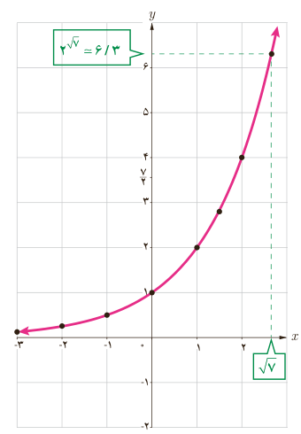
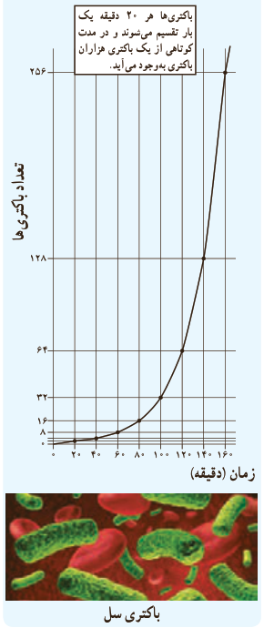

# درس اول | تابع نمایی و ویژگی‌های آن

هر تابع با ضابطه $f(x)=a^x$ که در آن $a\in\mathbb R$، $a>0$ و $a\ne1$، یک تابع نمایی نامیده می‌شود.

مثال: توابع با ضابطه‌های $y=2^x$ و $y=3^x$ و $y=(\frac12)^x$ و $y=(\frac14)^x$ نمونه‌ای از توابع نمایی هستند.

### فعالیت

در شکل مقابل نمودار تابع نمایی با ضابطه $y=2^x$ رسم شده است.

۱) محل تقاطع این نمودار با محور عرض‌ها چه نقطه‌ای است؟ ........

۲) دامنه و برد این تابع را به صورت بازه بنویسید. ........

۳) آیا این تابع یک‌به‌یک است؟ چرا؟ ........

۴) عدد $\sqrt2$ را روی محور $x$ها مشخص کنید و به کمک نمودار، مقدار $2^{\sqrt2}$ را به‌صورت تقریبی به دست آورید. ........

۵) عدد $\frac72$ روی محور $y$ها مشخص شده است. با استفاده از نمودار، مقدار تقریبی عدد $a$ را روی محور طول‌ها به‌دست آورید؛ به طوری که $\frac72\simeq2^a$. ........

۶) اعداد زیر را از کوچک به بزرگ مرتب کنید.

$$2^{-1},\quad2^{-0.4},\quad2^5,\quad2^{0.3},\quad2^{5/2},\quad2^{3/2},\quad2^{\sqrt5}$$

۷) در حالت کلی اگر $x<y$، چه رابطه‌ای بین $2^x$ و $2^y$ برقرار است؟ ........

### خواندنی

بیشتر باکتری‌ها در فاصله ۲۰ دقیقه به حداکثر رشد خود می‌رسند و قادر به تولیدمثل می‌شوند. در شرایط محیطی مساعد، باکتری با سرعت زیادی تکثیر می‌شود. مثلاً یک باکتری بعد از ۲۰ دقیقه به دو باکتری تبدیل می‌شود. ۲۰ دقیقه بعد، از آن دو باکتری، چهار باکتری به‌وجود می‌آید و به همین ترتیب تعداد باکتری‌ها به ۸، ۱۶، ۳۲، ۶۴، ۱۲۸، ۲۵۶ و ... می‌رسد. اگر این روش تکثیر باکتری‌ها تا ۲۴ ساعت ادامه یابد، از یک باکتری، توده‌ای از باکتری به وزن ۲۰۰۰ تن به‌وجود خواهد آمد! باکتری‌ها از طریق تولید سم یا تخریب سلول‌های بدن، باعث بیماری می‌شوند و به بدن آسیب می‌رسانند.

۹۹
