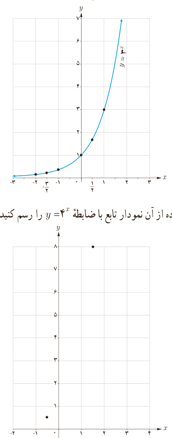

# فصل ۵ | توابع نمایی و لگاریتمی

### کار در کلاس

نمودار تابع با ضابطه $y=3^x$ با استفاده از نقاط جدول زیر رسم شده است.

| $x$ | −۲ | $-\frac32$ | −۱ | ۰ | $\frac12$ | ۱ |
|---|---|---|---|---|---|---|
| $y=3^x$ | ۰٫۱۱ | ۰٫۱۹ | ۰٫۳۳ | ۱ | ۱٫۷۳ | ۳ |

۱) جدول زیر را کامل کنید و با استفاده از آن نمودار تابع با ضابطه $y=4^x$ را رسم کنید.

| $x$ | ... | $-\frac12$ | ۰ | $\frac12$ | $\frac32$ |
|---|---|---|---|---|---|
| $y=4^x$ | $\frac14$ | $\frac12$ | ... | ... | ۸ |

۲) دامنه و برد توابع فوق را باهم مقایسه کنید. ........

۳) با استفاده از نمودار، در جاهای خالی علامت مناسب قرار دهید.

الف) $3^{2.5}\;\bigcirc\;3^{7/3}$؛ ب) $4^{\sqrt7}\;\bigcirc\;4^{\sqrt5}$.

۴) اگر $x<y$، در جاهای خالی علامت مناسب قرار دهید.

الف) $3^x\;\bigcirc\;3^y$؛ ب) $4^x\;\bigcirc\;4^y$.

### خواندنی

در اغلب ماشین حساب‌ها دکمه $x^y$ (یا $y^x$) وجود دارد که با استفاده از آن می‌توانید مقادیر اعداد توان‌دار را به دست آورید. برای مثال جهت محاسبه $2^5$، ابتدا عدد ۲ را وارد می‌کنید؛ سپس دکمه $x^y$ و بعد عدد ۵ و سپس دکمه تساوی را فشار می‌دهید که عدد ۳۲ ظاهر می‌شود. اگر عدد توان، طبیعی نبود، آن را داخل پرانتز قرار می‌دهیم. تذکر: در برخی از ماشین حساب‌ها به‌جای دکمه $x^y$، نمادی به صورت ^ وجود دارد که همان کار را انجام می‌دهد.

برای تمرین، مقادیر زیر را با استفاده از ماشین حساب به دست آورید. (تا یک رقم اعشار)

۱) $2^{\sqrt2}$؛ ۲) $2^{\sqrt8}$؛ ۳) $2^{0.1}$؛ ۴) $2^{-0.5}$؛ ۵) $2^{(1+\sqrt3)}$.

۱۰۰
