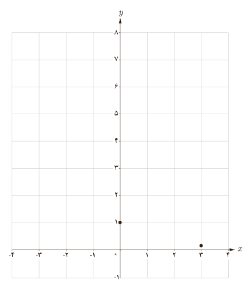
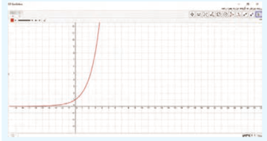

# درس اول | تابع نمایی و ویژگی‌های آن

### فعالیت

۱) با استفاده از جدول زیر، نمودار تابع با ضابطه $y=(\frac12)^x$ را رسم کنید.

| $x$ | −۳ | −۲ | ... | ۰ | ۱ | ... | ۳ |
|---|---|---|---|---|---|---|---|
| $y=(\frac12)^x$ | ... | ... | $\sqrt2$ | ۱ | ... | $\frac14$ | $\frac18$ |

۲) محل تقاطع نمودار این تابع با محور $y$ها چه نقطه‌ای است؟ ........

۳) دامنه و برد این تابع را بنویسید. ........

۴) آیا این تابع یک‌به‌یک است؟ چرا؟ ........

۵) با استفاده از نمودار فوق، در جاهای خالی علامت مناسب قرار دهید.

الف) $(\frac12)^{0.5}\;\bigcirc\;(\frac12)^{1.5}$؛ ب) $(\frac12)^{\sqrt2}\;\bigcirc\;(\frac12)^4$؛ پ) $(\frac12)^4\;\bigcirc\;(\frac12)^3$.

۶) با استفاده از نمودار، اگر $x<y$، چه رابطه‌ای بین $(\frac12)^x$ و $(\frac12)^y$ وجود دارد؟ ........

### خواندنی

با استفاده از نرم‌افزار جئوجبرا (GeoGebra) می‌توانید نمودارهای توابع نمایی را به راحتی رسم کنید. برای این کار در نوار دستور، ضابطه تابع را حروف‌چینی کرده و کلید Enter را بزنید. در پنجره گرافیکی، نمودار مطلوب نمایش داده می‌شود.

در تصویر مقابل، نمودار تابع با ضابطه $y=2^x$ در محیط این نرم‌افزار نمایش داده شده است.

۱۰۱
