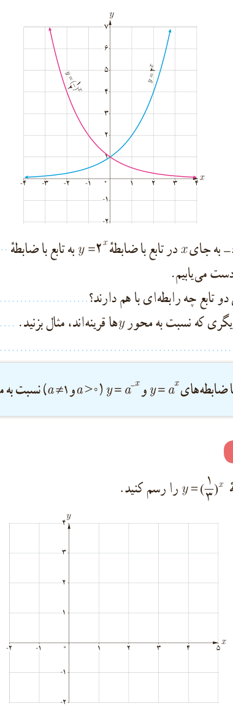
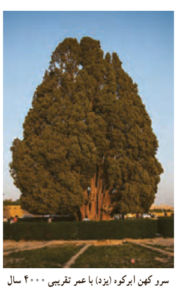

# فصل ۵ | توابع نمایی و لگاریتمی

### کار در کلاس

نمودار توابع با ضابطه‌های $y=2^x$ و $y=(\frac12)^x$ را در نظر بگیرید.

۱) نمودارهای این دو تابع نسبت به کدام محور مختصات قرینه‌اند؟ ........

۲) با جایگذاری $-x$ به جای $x$ در تابع با ضابطه $y=2^x$، به تابع با ضابطه $y=\ldots$ یا همان $y=\ldots$ دست می‌یابیم.

۳) دامنه و برد این دو تابع چه رابطه‌ای با هم دارند؟ ........

۴) دو تابع نمایی دیگری که نسبت به محور $y$ها قرینه‌اند، مثال بزنید. ........

نمودار توابع با ضابطه‌های $y=a^x$ و $y=a^{-x}$ ($a>0$ و $a\ne1$) نسبت به محور $y$ها قرینه‌اند.

### کار در کلاس

نمودار تابع با ضابطه $y=(\frac13)^x$ را رسم کنید.

### خواندنی

یک داروی بیماری آسم که به صورت قرص ۱۰۰ میلی‌گرمی موجود است، برای یک بیمار تجویز شده است. اگر او این قرص را مصرف کند و بدانیم در زمان مصرف دارو هیچ میزانی از آن در بدن وی موجود نیست، در این صورت می‌توان پیش‌بینی کرد که بعد از گذشت $t$ دقیقه، در مجموع از این دارو به میزان $A$ میلی‌گرم، در جریان خون او وجود خواهد داشت که از رابطه زیر به‌دست می‌آید:

$$A=100[1-(0.9)^t]$$

۱۰۲
