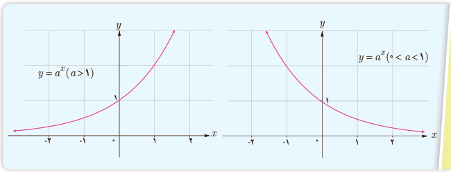

# درس اول | تابع نمایی و ویژگی‌های آن

### فعالیت

با توجه به مطالبی که در این درس آموخته‌اید، جملات زیر را تکمیل کنید.

۱) دامنه تابع با ضابطه $y=a^x$ ($a>1$) مجموعه اعداد حقیقی و برد آن ........ است.

۲) دامنه تابع با ضابطه $y=a^x$ ($0<a<1$) ........ و برد آن بازه $(0,+\infty)$ است.

۳) نمودار توابع فوق محور $y$ها را در نقطه ........ قطع می‌کند و محور $x$ها را در هیچ نقطه‌ای قطع نمی‌کند.

۴) این دو تابع، یک به یک ........ زیرا خطوط موازی محور $x$ها، نمودار آنها را حداکثر در ........ نقطه قطع می‌کند.

نمودار توابع نمایی در حالت کلی مشابه نمودارهای زیر است.

## معادلات نمایی

معادله‌ای را که در آن متغیر در توان قرار گرفته باشد، معادله نمایی می‌نامند. برای حل معادلات نمایی از خاصیت یک به یک بودن تابع نمایی استفاده می‌کنیم. اگر $a$ یک عدد حقیقی مثبت مخالف ۱ باشد و داشته باشیم $a^x=a^y$ آنگاه $x=y$ و برعکس.

مثال: معادله‌های نمایی مقابل را حل کنید.

الف) $3^{2x-3}=81\to3^{2x-3}=3^4\to2x-3=4\to x=\frac72$

ب) $4^{2x-1}=8^{x+1}\to(2^2)^{2x-1}=(2^3)^{x+1}\to4x-2=3x+3\to x=5$

پ) $5^{3n-1}=125^{2n+1}\to5^{3n-1}=5^{6n+3}\to3n-1=6n+3\to n=-\frac43$

۱۰۳
