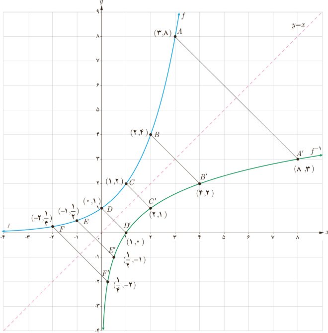

# درس دوم | تابع لگاریتمی و ویژگی‌های آن

بسیاری از اندازه‌گیری‌ها در علوم مختلف، طیف وسیعی از اعداد را در بر می‌گیرد که برای سادگی محاسبات، می‌توان آنها را توان‌هایی از یک عدد خاص در نظر گرفت و اندازه‌های بسیار بزرگ را در ابعاد بسیار کوچک‌تری نشان داد یا اندازه‌های بسیار کوچک را در ابعاد مناسب نمایش داد. کاربرد این ساده‌سازی محاسبات در علوم مختلف مانند فیزیک، شیمی، زیست‌شناسی، زمین‌شناسی، جمعیت‌شناسی، مهندسی و ... مشهود است.

## تابع لگاریتمی

### فعالیت

در درس اول با تابع نمایی با ضابطه $f(x)=2^x$ و نمودار آن آشنا شدیم. همان‌طور که مشاهده کردیم، این تابع یک به یک است؛ بنابراین وارون آن نیز یک تابع است. نمودار تابع $f$ و وارون آن، تابع $f^{-1}$ در دستگاه مختصات زیر رسم شده است که نسبت به خط $y=x$ قرینه‌اند.

### خواندنی

روش لگاریتم‌گیری در سال ۱۶۱۴ از سوی جان نِپِر (۱۵۵۰–۱۶۱۷)، ریاضی‌دان اسکاتلندی در کتابی با عنوان «توصیفی بر قانون شگفت‌انگیز لگاریتم» ارائه شد.

در فیزیک، مفهومی به‌نام شدت صوت وجود دارد که درک انسان را از بلندی صوت بیان می‌کند. تراز شدت یک صوت عبارت است از لگاریتم (در پایه ده) نسبت شدت آن صوت به شدت صوت مبنا. تراز شدت صوت را با $\beta$ نشان می‌دهند و یکای آن را به افتخار بل فیزیکدان آمریکایی مخترع تلفن، بل (B) و دسی‌بل (dB) نام‌گذاری کرده‌اند. هر بل برابر ده دسی‌بل است. ($I_0$ شدت صوت مبناست که برابر آستانه شنوایی گوش سالم است.)

$$\beta=\log_{I_0}I$$

| صدا | تراز شدت صوت dB |
|---|---|
| شدت صوت مبنا | ۰ |
| نفس کشیدن | ۱۰ |
| برگ درختان در نسیم | ۲۰ |
| صحبت کردن از فاصله یک متری | ۴۰ |
| همهمه در فروشگاه | ۶۰ |
| سر و صدای خودروها در خیابان شلوغ | ۷۰ |
| آستانه دردناکی (برای بسامد ۱۰۰۰ Hz) | ۱۲۰ |
| مسلسل | ۱۳۰ |
| غرش هواپیمای جت در حین بلند شدن | ۱۴۰ |
| راکت فضایی، در موقع بلند شدن | ۱۷۰ |

۱۰۵
