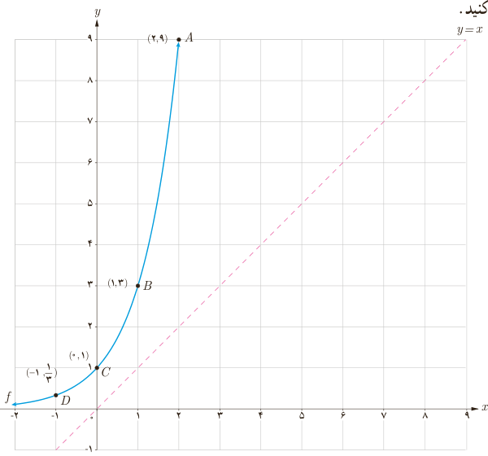

# فصل ۵ | توابع نمایی و لگاریتمی

۱) دامنه و برد دو تابع $f$ و $f^{-1}$ در نمودار قبل را به‌دست آورید. ........

۲) با توجه به نقاط $f$ و $f^{-1}$ در نمودار، جدول زیر را تکمیل کنید.

| $f(-2)=\frac14$ | $f(-1)=\ldots$ | $f(0)=\ldots$ | $f(2)=\ldots$ |
|---|---|---|---|
| $f^{-1}(\frac14)=\ldots$ | $f^{-1}(\frac12)=\ldots$ | $f^{-1}(1)=\ldots$ | $f^{-1}(4)=\ldots$ |

### فعالیت

نمودار تابع با ضابطه $f(x)=3^x$ در دستگاه مختصات زیر رسم شده است.

۱) با توجه به نقاط نمودار $f$، نمودار $f^{-1}$ را رسم کنید.

۲) با توجه به نقاط $f$ و $f^{-1}$ در نمودار قبل، جاهای خالی را تکمیل کنید.

| $f(-2)=\frac19$ | $f(0)=\ldots$ | $f(1)=\ldots$ | $f(\ldots)=9$ |
|---|---|---|---|
| $f^{-1}(\frac19)=\ldots$ | $f^{-1}(1)=\ldots$ | $f^{-1}(\ldots)=1$ | $f^{-1}(9)=\ldots$ |

۳) دامنه و برد دو تابع $f$ و $f^{-1}$ را به‌دست آورید. ........

با توجه به مطالب فوق، وارون تابع با ضابطه $f(x)=3^x$ را به‌صورت $f^{-1}(x)=\log_3x$ نشان می‌دهیم و آن را لگاریتم $x$ در مبنای ۳ می‌نامیم. به عبارت دیگر توابع نمایی و لگاریتمی وارون یکدیگرند.

۴) با توجه به نمودار توابع نمایی و لگاریتمی، دامنه و برد آنها را به‌طور کلی بنویسید. ........

۱۰۶
