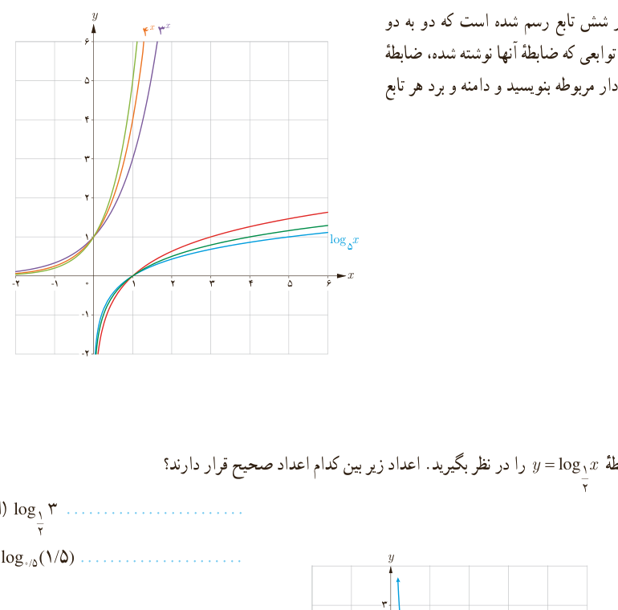

# درس دوم | تابع لگاریتمی و ویژگی‌های آن

وارون تابع نمایی با ضابطه $f(x)=a^x$ را به‌صورت $f^{-1}(x)=\log_a x$ نشان می‌دهیم و آن را لگاریتم $x$ در مبنای $a$ می‌نامیم. به عبارت دیگر برای هر عدد حقیقی مثبت $a$ ($a\ne1$) داریم:

$$f(x)=a^x\iff f^{-1}(x)=\log_a x$$

### کار در کلاس

در شکل مقابل، نمودار شش تابع رسم شده است که دو به دو وارون یکدیگرند. برای توابعی که ضابطه آنها نوشته شده، ضابطه وارون آنها را روی نمودار مربوطه بنویسید و دامنه و برد هر تابع را مشخص کنید.

### کار در کلاس

۱) نمودار تابع با ضابطه $y=\log_{1/2}x$ را در نظر بگیرید. اعداد زیر بین کدام اعداد صحیح قرار دارند؟

الف) $\log_{1/2}3$ ........

ب) $\log_{0.5}(1.5)$ ........

۱۰۷
