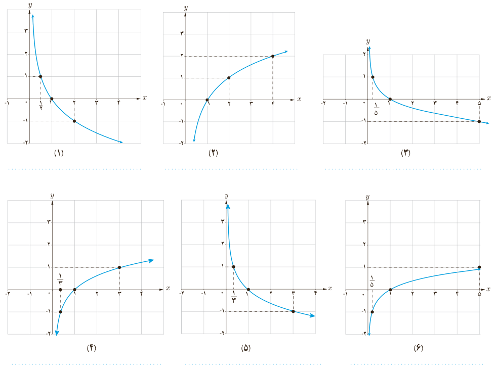

# فصل ۵ | توابع نمایی و لگاریتمی

۲) نمودار چند تابع لگاریتمی در زیر رسم شده است. ضابطه مربوط به هر کدام را بنویسید.

۳) با توجه به نمودارهای سؤال ۲، جدول زیر را کامل کنید.

| شماره نمودار | $(1,0)$ | $(2,1)$ | $(\frac12,1)$ | $(\frac13,1)$ | $(\frac13,-1)$ | $(4,2)$ | $(4,-2)$ | $(0,1)$ |
|---|---|---|---|---|---|---|---|---|
| ۱ | | × | | | | | | |
| ۲ | | ✓ | | | | | | |
| ۳ | | × | | | | | | |
| ۴ | | × | | | | | | |
| ۵ | | × | | | | | | |
| ۶ | | × | | | | | | |

۱۰۸
