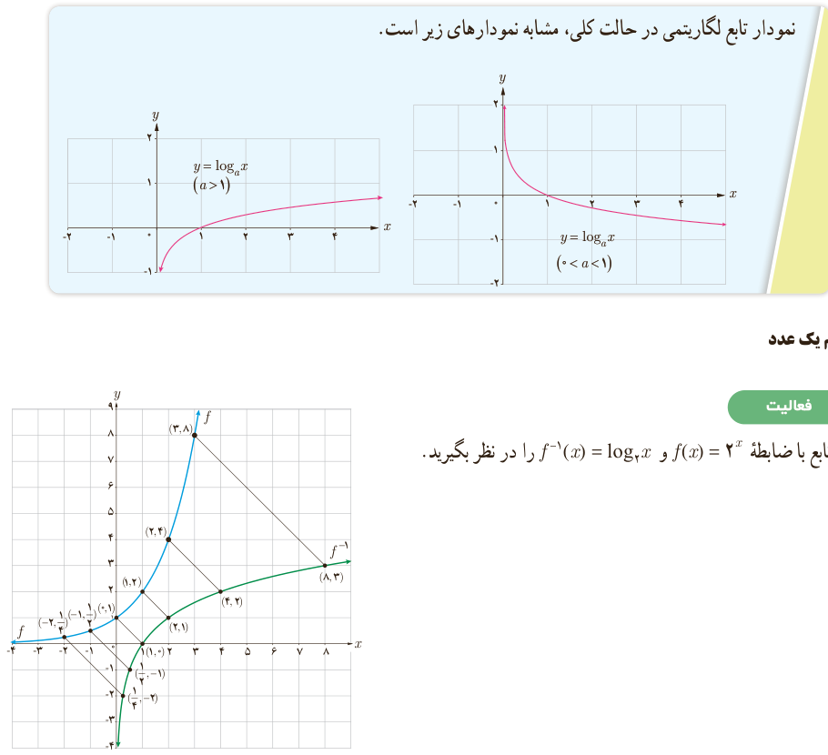

# درس دوم | تابع لگاریتمی و ویژگی‌های آن

### فعالیت

با توجه به مطالبی که تا به حال خوانده‌اید، جملات زیر را تکمیل کنید.

۱) دامنه تابع با ضابطه $y=\log_a x$ ($a>1$)، مجموعه اعداد حقیقی مثبت و برد آن ........ است.

۲) دامنه تابع با ضابطه $y=\log_a x$ ($0<a<1$)، بازه ........ و برد آن ........ است.

۳) نمودار توابع فوق، محور $x$ها را در نقطه ........ قطع می‌کند و محور $y$ها را قطع نمی‌کند.

۴) این دو تابع، یک‌به‌یک ........ زیرا خطوط موازی محور $x$ها، نمودار آنها را حداکثر در ........ نقطه قطع می‌کند.

۵) وارون تابع نمایی، تابع ........ است و وارون تابع لگاریتمی، تابع ........ است.

اگر $a$ عدد حقیقی مثبت ($a\ne1$) باشد، داریم: $a^0=1$، بنابراین همواره:

$$\log_a1=0$$

نمودار تابع لگاریتمی در حالت کلی، مشابه نمودارهای زیر است.

## لگاریتم یک عدد

### فعالیت

نمودار تابع با ضابطه $f(x)=2^x$ و $f^{-1}(x)=\log_2x$ را در نظر بگیرید.

۱۰۹
