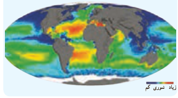

# فصل ۵ | توابع نمایی و لگاریتمی

### کار در کلاس

اگر $\log2\simeq0.3$ و $\log3\simeq0.48$، مقادیر تقریبی اعداد زیر را به‌دست آورید.

۱) $\log12=\log(3\times4)=\log3+\log2^2=\log3+2\log2\simeq0.48+0.6=1.08$

۲) $\log0.75=\ldots$؛ ۳) $\log\sqrt5=\ldots$؛ ۴) $\log\frac{25}{18}=\ldots$؛ ۵) $\log\sqrt[3]6=\ldots$؛ ۶) $\log\frac{\sqrt{27}}{\sqrt[4]5}=\ldots$.

## معادلات لگاریتمی

یکی از مهم‌ترین کاربردهای لگاریتم، حل معادلات لگاریتمی است که معمولاً از مدل‌سازی یک مسئله واقعی به‌دست می‌آید. مانند محاسبه شدت زلزله، مشخص کردن ضعیف‌ترین صدای قابل شنیدن یا آستانه شنوایی، پیش‌بینی تعداد جمعیت یک جامعه پس از زمان مشخص و محاسبه نیمه عمر عناصر رادیواکتیو. معادلات زیر نمونه‌هایی از معادلات لگاریتمی‌اند:

$$\log_2x+1=3,\quad\log_3x=\log_37,\quad\log_5x+\log_5(x-1)=\log_512$$

منظور از حل معادله لگاریتمی، پیدا کردن مقادیری برای مجهول است که در معادله صدق کند.

به‌طور کلی اگر $a$ یک عدد حقیقی مثبت ($a\ne1$)، باشد آنگاه با توجه به یک‌به‌یک بودن تابع لگاریتمی، از تساوی $\log_a x=\log_a y$ ($x,y>0$) می‌توان نتیجه گرفت $x=y$ و به عکس، اگر $x=y$ ($x,y>0$) آنگاه $\log_a x=\log_a y$.

### فعالیت

معادلات لگاریتمی زیر را حل کنید.

۱) $\log_3x=2\to x=3^2=9$

۲) $\log_5(x+6)=\log_5(2x-3)\to x+6=2x-3\to x=9$ که $x=9$ برای هر دو لگاریتم قابل قبول است.

۳) $\log_5(x+6)+\log_5(x+2)=1\to\log_5[(x+6)(x+2)]=1$

$$\to(x+6)(x+2)=5\to x^2+8x+12=5\to x^2+8x+7=0\to(x+7)(x+1)=0\to x=-7\ یا\ x=-1$$

توجه کنید که $x=-7$ قابل قبول نیست؛ از این‌رو تنها جواب $x=-1$ قابل قبول است که در معادله اصلی صدق می‌کند.

### خواندنی

لاپلاس دانشمند بزرگ فرانسوی درباره لگاریتم گفته است: «لگاریتم ابزاری است قابل ستایش که به کمک آن کار چند ماه به چند روز کاهش می‌یابد، عمر اخترشناسان را دو برابر می‌کند و از خطاهای کوچک می‌گذرد و از عبارات طولانی و جدا نشدنی ریاضی بیزار است.»

شوری آب اقیانوس‌ها با عرض جغرافیایی (فاصله از خط استوا) و عمق اقیانوس تغییر می‌کند. در مناطق استوایی میزان شوری آب در سطح اقیانوس‌ها به دلیل تبخیر سریع آب، بیشتر است. هرچه به قطب نزدیک‌تر می‌شویم، کاهش تبخیر و بارش باران باعث می‌شود شوری سطح آب کاهش یابد. تابع مربوطه عبارت است از:

$$S(x)=31.5+1.1\log(x+1)$$

که در این رابطه $x$ نشان‌دهنده عمق به متر و $S(x)$ نشان‌دهنده مقدار گرم نمک موجود در هر کیلوگرم آب اقیانوس است.

۱۱۲
