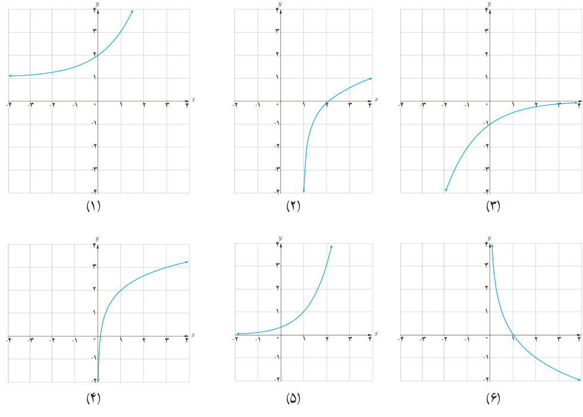

# درس سوم | نمودارها و کاربردهای توابع نمایی و لگاریتمی

## نمودارهای توابع نمایی و لگاریتمی

در درس اول و دوم با نمودار توابع نمایی و لگاریتمی آشنا شدیم. نمودار این توابع را می‌توان با استفاده از قوانینی که قبلاً فرا گرفته‌ایم، انتقال دهیم.

با توجه به آنچه که در مبحث انتقال توابع گفته شد، فعالیت زیر را انجام دهید.

### فعالیت

نمودار هر تابع را به ضابطه آن نظیر کنید.

الف) $k(x)=-\log_2x$؛ ب) $l(x)=2+\log_2x$؛ پ) $h(x)=-(\frac12)^x$؛ ت) $g(x)=\log_2(x-1)$؛ ث) $j(x)=3^{(x-1)}$؛ ج) $f(x)=2^x+1$.

۱۱۵
