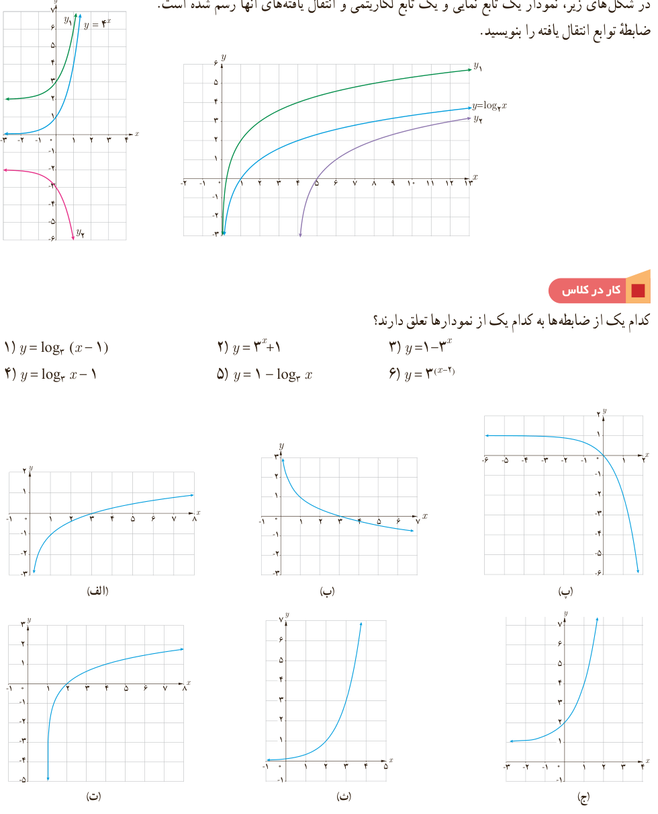

# فصل ۵ | توابع نمایی و لگاریتمی

### کار در کلاس

در شکل‌های زیر، نمودار یک تابع نمایی و یک تابع لگاریتمی و انتقال یافته‌های آنها رسم شده است. ضابطه توابع انتقال یافته را بنویسید.

### کار در کلاس

کدام یک از ضابطه‌ها به کدام یک از نمودارها تعلق دارند؟

۱) $y=\log_2(x-1)$؛ ۲) $y=3^x+1$؛ ۳) $y=1-3^x$؛ ۴) $y=\log_3x-1$؛ ۵) $y=1-\log_3x$؛ ۶) $y=3^{(x-2)}$.

۱۱۶
