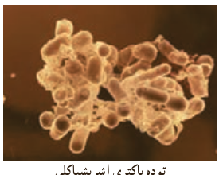

# درس سوم | نمودارها و کاربردهای توابع نمایی و لگاریتمی

## کاربرد توابع نمایی و لگاریتمی

### تابع نمایی

در حالت کلی یک تابع به‌صورت $h(x)=ka^x$ ($a>0$، $a\ne1$) رفتار نمایی دارد که در بسیاری از مسائل اقتصادی، طبیعی و مهندسی و ... ظاهر می‌شود.

مثال: اشرشیاکلی (Escherichia coli) یا به‌طور اختصار E.coli نوعی باکتری است که به‌طور طبیعی در دستگاه گوارش زندگی می‌کند و تکثیر آن به‌صورت نمایی است. عوامل مختلفی مانند زیاد شدن آن باعث بیماری می‌شود. نوع خاصی از این بیماری با ۱۰۰ باکتری شروع می‌شود و هر باکتری در مدت نیم ساعت به دو قسمت تقسیم می‌شود. اندازه هر توده باکتری بعد از $t$ ساعت از رابطه زیر به‌دست می‌آید:

$$p(t)=100\times2^{2t}\qquad(0\leq t\leq16)$$

با فرض اینکه هیچ کدام از باکتری‌ها از بین نروند، تعداد باکتری‌ها در یک توده پس از ۳ ساعت برابر است با:

$$p(3)=100\times2^6=6400$$

### تابع لگاریتمی

ریشتر، مقیاسی برای اندازه‌گیری بزرگی زمین‌لرزه است که میزان انرژی آزادشده در زلزله را نشان می‌دهد. اگر بزرگی زلزله‌ای برابر $M$ در مقیاس ریشتر باشد، انرژی آزاد شده آن زلزله برابر $E$ در واحد اِرگ (Erg) است که از رابطه زیر به‌دست می‌آید:

$$\log E=11.8+1.5M$$

انرژی یک زلزله ۸ ریشتری تقریباً برابر با انرژی انفجار یک میلیارد تن ماده انفجاری TNT است.

مثال: روز پنجم دی ماه ۱۳۸۲ زلزله‌ای به شدت ۶٫۶ ریشتر، شهر بم و مناطق اطراف آن را در شرق استان کرمان لرزاند. مقدار انرژی آزاد شده در این زلزله چقدر بوده است؟

$$\log E=11.8+1.5M\to\log E=11.8+1.5(6.6)\to\log E=21.7\to E=10^{21.7}\,Erg$$

### کار در کلاس

زلزله ۳۱ خرداد سال ۱۳۶۹ رودبار – منجیل به بزرگی ۷٫۴ ریشتر در ساعت سی دقیقه بامداد رخ داد. مقدار انرژی آزاد شده در این زلزله را محاسبه کنید.

۱۱۷
