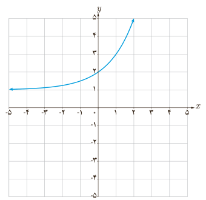

# فصل ۵ | توابع نمایی و لگاریتمی

### تمرین

۱) در دستگاه مختصات روبه‌رو نمودار تابع با ضابطه $y=a+2^{(x-b)}$ رسم شده است. $a$ و $b$ را به‌دست آورید.

۲) فرض می‌کنیم $g(x)=4^x+2$. الف) $g(-1)$ را به‌دست آورید. ب) اگر $g(x)=66$، مقدار $x$ چقدر است؟

۳) نمودار تابع با ضابطه $y=4^x-1$ را در بازه $[-2,2]$ رسم کنید.

۴) نمودار توابع با ضابطه‌های زیر را رسم کنید.

الف) $y=-2^x+1$؛ ب) $y=-\log_2(x-1)$؛ پ) $y=2^{|x|}$؛ ت) $y=\frac{|x|}{x}\log x$.

۱۱۸
