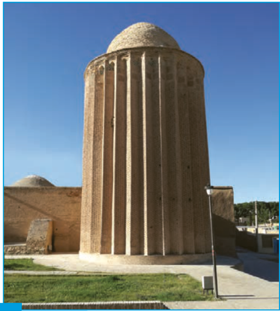

# فصل ۶ | حد و پیوستگی

برج کاشانه در نزدیکی مسجد جامع شهر بسطام قرار دارد. بسطام در شمال شاهرود و در استان سمنان واقع است. قدمت این برج حدود ۷۰۰ سال است و ارتفاع برج از داخل ۲۴ و از بیرون ۲۰ متر است. فضای داخلی برج ده ضلعی و نمای بیرونی آن سی ضلعی منتظم است.

- درس اول: فرایندهای حدی
- درس دوم: محاسبه حد توابع
- درس سوم: پیوستگی
