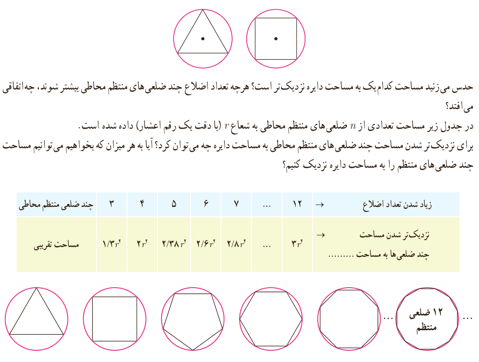

# فصل ۶ | حد و پیوستگی
## درس اول: فرایندهای حدی

### فعالیت

در دایره‌های زیر به شعاع $r$ یک مثلث متساوی‌الاضلاع و یک مربع به گونه‌ای رسم شده‌اند که رأس‌های آنها روی دایره واقع‌اند. چنین چند ضلعی‌هایی را محاطی می‌نامیم. واضح است که مساحت مثلث متساوی‌الاضلاع و مساحت مربع از مساحت دایره کمتر است.

حدس می‌زنید مساحت کدام یک به مساحت دایره نزدیک‌تر است؟ هرچه تعداد اضلاع چند ضلعی‌های منتظم محاطی بیشتر شوند، چه اتفاقی می‌افتد؟

در جدول زیر مساحت تعدادی از $n$ ضلعی‌های منتظم محاطی به شعاع $r$ (با دقت یک رقم اعشار) داده شده است. برای نزدیک‌تر شدن مساحت چند ضلعی‌های منتظم محاطی به مساحت دایره چه می‌توان کرد؟ آیا به هر میزان که بخواهیم می‌توانیم مساحت چند ضلعی‌های منتظم را به مساحت دایره نزدیک کنیم؟

| چند ضلعی منتظم محاطی | ۳ | ۴ | ۵ | ۶ | ۷ | ... | ۱۲ | زیاد شدن تعداد اضلاع → |
|---|---|---|---|---|---|---|---|---|
| مساحت تقریبی | $1.3r^2$ | $2r^2$ | $2.38r^2$ | $2.6r^2$ | $2.8r^2$ | ... | $3r^2$ | نزدیک‌تر شدن مساحت چند ضلعی‌ها به مساحت ........ → |

مساحت چند ضلعی‌های منتظم محاط در دایره را به هر میزان که بخواهیم می‌توانیم به مساحت دایره نزدیک‌تر کنیم، به شرط آنکه تعداد اضلاع چند ضلعی را به مقدار کافی بزرگ اختیار کنیم. (به بیان دیگر با افزایش تعداد اضلاع، مساحت چند ضلعی‌ها به مساحت دایره نزدیک می‌شود.)

۱۲۰
