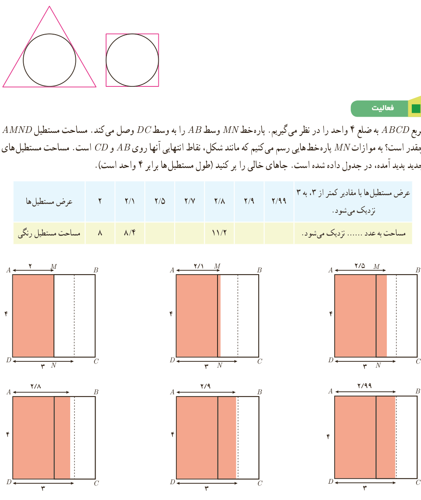

# درس اول | فرایندهای حدی

### کار در کلاس

فرض کنید در فعالیت قبل برای دایره به شعاع $r$ از چند ضلعی‌های منتظم محیطی (چند ضلعی که همه اضلاع آن بر یک دایره مماس باشند) استفاده کنیم. نتیجه مشابه آنچه را در فعالیت قبل به‌دست آمد، درباره این چند ضلعی‌ها بیان کنید (محاسبه مساحت‌ها لازم نیست).

### فعالیت

مربع $ABCD$ به ضلع ۴ واحد را در نظر می‌گیریم. پاره‌خط $MN$ وسط $AB$ را به وسط $DC$ وصل می‌کند. مساحت مستطیل $AMND$ چقدر است؟ به موازات $MN$ پاره‌خط‌هایی رسم می‌کنیم که مانند شکل، نقاط انتهایی آنها روی $AB$ و $CD$ است. مساحت مستطیل‌های جدید پدید آمده، در جدول داده شده است. جاهای خالی را پر کنید (طول مستطیل‌ها برابر ۴ واحد است).

| عرض مستطیل‌ها | ۲ | ۲٫۱ | ۲٫۵ | ۲٫۷ | ۲٫۸ | ۲٫۹ | ۲٫۹۹ | عرض مستطیل‌ها با مقادیر کمتر از ۳، به ۳ نزدیک می‌شود. |
|---|---|---|---|---|---|---|---|---|
| مساحت مستطیل رنگی | ۸ | ۸٫۴ | | | ۱۱٫۲ | | | مساحت به عدد ........ نزدیک می‌شود. |

۱۲۱
