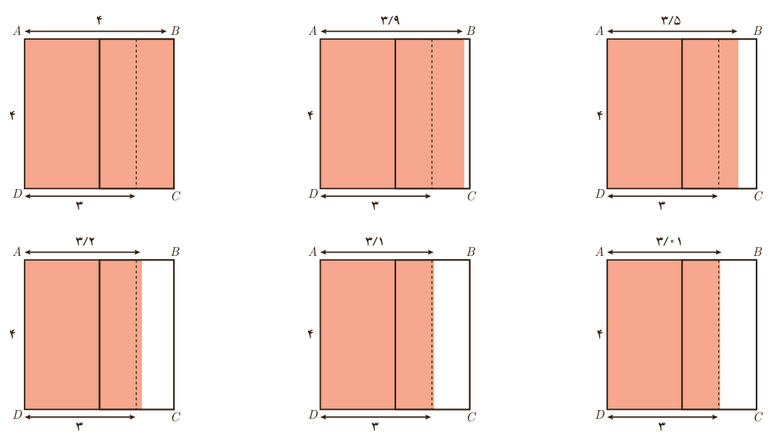

# فصل ۶ | حد و پیوستگی

مشابه همین کار را با شروع از پاره‌خط $BC$ انجام می‌دهیم. پاره‌خط‌هایی که به موازات $BC$ رسم می‌شوند، همانند شکل زیر، مستطیل‌های جدیدی را می‌سازند. جدول را کامل کنید.

| عرض مستطیل‌ها | ۴ | ۳٫۹ | ۳٫۵ | ۳٫۲ | ۳٫۱ | ۳٫۰۱ | عرض مستطیل‌ها با مقادیر بیشتر از ۳، به ۳ نزدیک می‌شود. |
|---|---|---|---|---|---|---|---|
| مساحت مستطیل رنگی | ۱۶ | ۱۵٫۶ | ۱۴ | ۱۲٫۸ | | | مساحت به عدد ........ نزدیک می‌شود. |

اگر طول مستطیل‌ها را ۴ و عرض آنها را $x$ در نظر بگیریم، مساحت مستطیل‌ها را می‌توان به‌صورت تابع $f(x)=4x$ نمایش داد. با این تفاوت که در حالت اول $x$، با مقادیر کمتر از عدد ۳، به سمت عدد ۳ نزدیک می‌شود و در حالت دوم $x$، با مقادیر بیشتر از عدد ۳ به سمت عدد ۳ نزدیک می‌شود. این دو وضعیت را به ترتیب با نمادهای $x\to3^-$ و $x\to3^+$ نمایش می‌دهیم. خلاصه دو جدول قبل در جدول زیر ارائه شده است:

| $x$ | ۲ | ۲٫۱ | ۲٫۵ | ۲٫۸ | ۲٫۹ | ۲٫۹۹ | $\to3\leftarrow$ | ۳٫۰۱ | ۳٫۱ | ۳٫۲ | ۳٫۵ | ۳٫۹ | ۴ |
|---|---|---|---|---|---|---|---|---|---|---|---|---|---|
| $f(x)$ | ۸ | ۸٫۴ | | | | | $\to12\leftarrow$ | | | | | | ۱۶ |

$x$ از سمت چپ به ۳ نزدیک می‌شود و $f(x)$ به ۱۲ نزدیک می‌شود. $x$ از سمت راست به ۳ نزدیک می‌شود و $f(x)$ به ۱۲ نزدیک می‌شود.

۱۲۲
