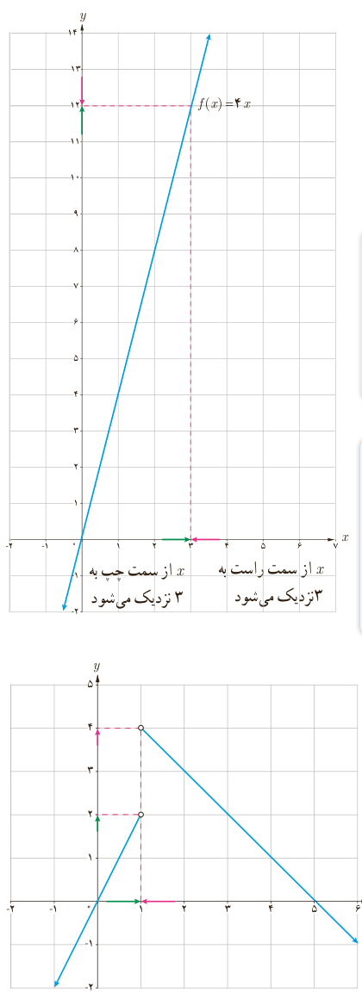

# درس اول | فرایندهای حدی

وقتی $x\to3^+$ گوییم $x$ از راست به ۳ نزدیک می‌شود و وقتی $x\to3^-$ می‌گوییم $x$ از چپ به ۳ نزدیک می‌شود. در حقیقت رفتار تابع در نزدیکی نقطه ۳ بررسی شده است.

دیدیم که وقتی $x\to3^-$ مساحت مستطیل‌ها یا همان مقادیر $f(x)$ به مقدار دلخواه به ۱۲ نزدیک می‌شود. در این حالت می‌گوییم حد تابع $f(x)$ وقتی $x$ از چپ به ۳ نزدیک می‌شود، برابر ۱۲ است و می‌نویسیم:

$$\lim_{x\to3^-}f(x)=12$$

به طریق مشابه وقتی $x\to3^+$ باز هم مساحت مستطیل‌ها به مقدار دلخواه به ۱۲ نزدیک می‌شود. در این حالت هم می‌گوییم حد تابع $f(x)$ وقتی $x$ از سمت راست به ۳ نزدیک می‌شود، برابر ۱۲ است و می‌نویسیم:

$$\lim_{x\to3^+}f(x)=12$$

اگر حد راست و حد چپ یک تابع در یک نقطه، موجود و برابر باشند، تابع در آن نقطه حد دارد. در این فعالیت حد راست و حد چپ تابع وقتی $x$ به ۳ نزدیک می‌شود، موجود و برابر ۱۲ است. به‌طور خلاصه می‌نویسیم:

$$\lim_{x\to3}f(x)=12$$

مثال: نمودار تابع با ضابطه زیر رسم شده است.

$$f(x)=\begin{cases}2x&x<1\\-x+5&x>1\end{cases}$$

جدول صفحه بعد را کامل کنید و با استفاده از آن و به کمک نمودار $\lim_{x\to1^+}f(x)$ و $\lim_{x\to1^-}f(x)$ را محاسبه کنید.

۱۲۳
