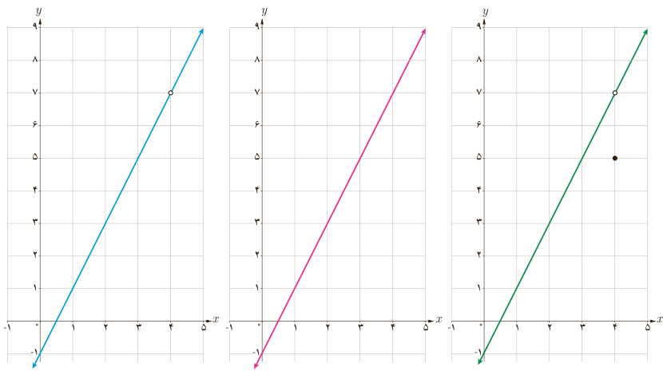

# درس اول | فرایندهای حدی

بسیاری از پدیده‌های طبیعی قابل ارائه در قالب یک تابع‌اند. در بسیاری از مواقع لازم است رفتار یک تابع را در نزدیکی یک نقطه بررسی کنیم. در فعالیت زیر رفتار سه تابع را در نزدیکی یک نقطه بررسی خواهیم کرد تا با مفهوم حد بهتر آشنا شویم.

### فعالیت

نمودار توابع زیر رسم شده‌اند:

$$f(x)=2x-1,\quad g(x)=\begin{cases}2x-1&x\ne4\\5&x=4\end{cases},\quad h(x)=2x-1\quad(x\ne4)$$

هر نمودار به کدام تابع تعلق دارد؟ آیا این سه تابع با یکدیگر برابرند؟ دامنه و برد این سه تابع را معلوم کنید.

می‌خواهیم رفتار این سه تابع را در نزدیکی نقطه ۴ بررسی کنیم. ابتدا جدول را کامل کنید.

| $x$ | ۳ | ۳٫۵ | ۳٫۸ | ۳٫۹ | ۳٫۹۹ | $\to4\leftarrow$ | ۴٫۰۱ | ۴٫۱ | ۴٫۲ | ۴٫۵ | ۵ |
|---|---|---|---|---|---|---|---|---|---|---|---|
| $f(x)$ | ۵ | ۶ | ۶٫۶ | | | $\to7\leftarrow$ | | | ۷٫۴ | ۸ | ۹ |
| $g(x)$ | | | | | | $\to\leftarrow$ | | | | | |
| $h(x)$ | | | | | | $\to\leftarrow$ | | | | | |

مقادیر $f$، $g$ و $h$ را به هر اندازه که بخواهیم می‌توانیم به عدد ... نزدیک کنیم؛ به شرط آنکه مقادیر $x$ به قدر کافی به عدد ... نزدیک شود. حد هر سه تابع وقتی که $x\to4$ (بخوانید $x$ به سمت ۴ میل می‌کند) برابر ... است. به عبارت دیگر:

$$\lim_{x\to4}f(x)=\qquad\lim_{x\to4}g(x)=\qquad\lim_{x\to4}h(x)=$$

۱۲۵
