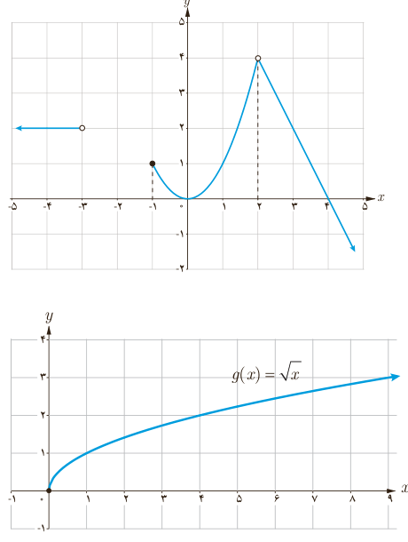

# فصل ۶ | حد و پیوستگی

در فعالیت قبل مشاهده کردید که سه تابع $f$، $g$ و $h$ در نزدیکی نقطه $x=4$ رفتار یکسانی دارند. به عبارت دیگر حد آنها وقتی $x$ به ۴ نزدیک می‌شود، برابر ۷ است. با این حال درباره مقادیر این سه تابع در نقطه ۴ داریم:

الف) $h(4)$ وجود ندارد ($h$ در ۴ تعریف نشده است).

ب) $g(4)$ موجود است؛ ولی $\lim_{x\to4}g(x)\ne g(4)$.

پ) $f(4)=7$ و $\lim_{x\to4}f(x)=7$.

به‌طور کلی اگر درباره تابعی مانند $f$ داشته باشیم $\lim_{x\to a}f(x)=l$، آنگاه درباره $f(a)$ یکی از حالت‌های زیر را داریم:

الف) $f(a)$ موجود نیست.

ب) $f(a)$ موجود است؛ ولی $\lim_{x\to a}f(x)\ne f(a)$.

پ) $\lim_{x\to a}f(x)=f(a)$.

مثال ۱: در شکل زیر نمودار تابع زیر رسم شده است.

$$f(x)=\begin{cases}-2x+8&x>2\\x^2&-1\leq x<2\\2&x<-3\end{cases}$$

الف) $f(2)$ تعریف نشده است؛ ولی $\lim_{x\to2}f(x)=4$.

ب) $\lim_{x\to-1^+}f(x)=1$ ولی $\lim_{x\to-1}f(x)$ وجود ندارد.

پ) $f(-1)=1$.

ت) $\lim_{x\to0}f(x)=0$ و $f(0)=0$.

ث) $\lim_{x\to4}f(x)=0$ و $f(4)=0$.

ج) $f(-3)$ و $\lim_{x\to-3^+}f(x)$ وجود ندارند؛ ولی $\lim_{x\to-3^-}f(x)=2$.

مثال ۲: برای تابع $g(x)=\sqrt x$ داریم:

الف) $\lim_{x\to0^+}\sqrt x=0$.

ب) $\lim_{x\to0^-}\sqrt x$ وجود ندارد؛ زیرا تابع برای $x<0$ تعریف نشده است.

پ) $\lim_{x\to0}\sqrt x$ وجود ندارد.

۱۲۶
