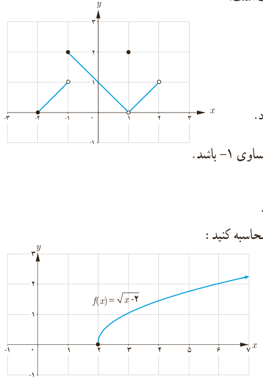

# درس اول | فرایندهای حدی

### تمرین

۱) برای تابع $f$ که نمودار آن داده شده، کدام یک درست و کدام یک نادرست است؟

الف) $\lim_{x\to1}f(x)=2$؛ ب) $f(1)=2$؛ پ) $f(2)=1$؛ ت) $\lim_{x\to-2^+}f(x)=0$؛ ث) $\lim_{x\to-1}f(x)=2$؛ ج) $\lim_{x\to0}f(x)=1$؛ چ) $\lim_{x\to2}f(x)$ وجود ندارد؛ ح) $\lim_{x\to-1}f(x)$ وجود ندارد.

۲) مثالی از یک تابع، همراه با نمودار آن ارائه کنید که حد تابع در نقطه ۲ مساوی ۱− باشد.

۳) تابعی مانند $f$ ارائه کنید که در نقطه ۳ حد نداشته باشد. $f(3)=1$.

۴) تابعی مانند $f$ ارائه کنید که در نقطه ۲ تعریف نشده باشد. $\lim_{x\to2}f(x)=4$.

۵) درباره تابع با ضابطه $f(x)=\sqrt{x-2}$ موارد زیر را در صورت وجود محاسبه کنید:

الف) $\lim_{x\to2^+}f(x)$؛ ب) $\lim_{x\to2^-}f(x)$؛ پ) $\lim_{x\to2}f(x)$؛ ت) $f(2)$.

۶) تابع با ضابطه $f(x)=\begin{cases}x&x>0\\-x&x<0\end{cases}$ را در نظر می‌گیریم. آیا در نقطه صفر حد دارد؟ آیا $f(0)$ موجود است؟

۷) توابع زیر را در نظر بگیرید و به سؤالات پاسخ دهید:

$$f(x)=2x+1,\quad g(x)=2x+1\ (x\ne2),\quad h(x)=\begin{cases}2x+1&x\ne2\\3&x=2\end{cases}$$

الف) مقادیر $f(2)$، $h(2)$ و $g(2)$ را در صورت وجود به‌دست آورید.

ب) حدهای زیر را محاسبه کنید: $\lim_{x\to2}f(x)$، $\lim_{x\to2}g(x)$، $\lim_{x\to2}h(x)$.

۸) آیا حد تابع زیر در $x=2$ موجود است؟

$$f(x)=\begin{cases}-x+2&x>2\\-2&x=2\\x-3&x<2\end{cases}$$

۹) نمودار تابع با ضابطه $f(x)=\begin{cases}x^2+2&x>0\\-2x-2&x\leq0\end{cases}$ را رسم کنید و حد تابع در صفر را ـ در صورت وجود ـ بیابید.

۱۰) اگر $f(x)=\frac{|x|}{x}$، نمودار $f$ را رسم کنید. آیا $\lim_{x\to0}f(x)$ موجود است؟

۱۲۷
