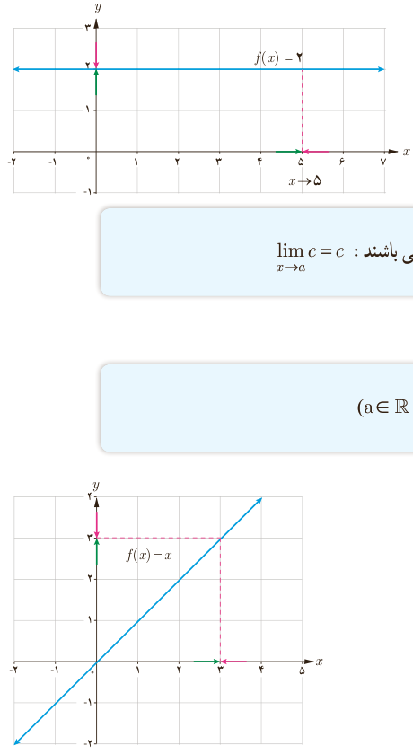

# فصل ۶ | حد و پیوستگی
## درس دوم: محاسبه حد توابع

یکی از عواملی که به مطالعه دقیق‌تر یک تابع می‌تواند کمک کند، محاسبه حد آن تابع است. برای محاسبه حد یک تابع قواعد و دستورهایی وجود دارد. در این درس برخی از این قواعد به کمک شهود و با ذکر مثال توضیح داده می‌شوند.

### ۱ـ حد تابع ثابت

حد تابع ثابت در هر نقطه برابر مقدار تابع ثابت است. به‌طور مثال: $\lim_{x\to5}f(x)=2$.

به‌طور کلی اگر $c$ و $a$ دو عدد حقیقی باشند: $\lim_{x\to a}c=c$.

### ۲ـ حد تابع همانی

اگر $f(x)=x$، آنگاه $\lim_{x\to a}x=a$ ($a\in\mathbb R$).

به‌طور مثال: $\lim_{x\to3}x=3$.

### کار در کلاس

حدهای زیر را حساب کنید:

$$\lim_{x\to7}x=\ldots\qquad\lim_{x\to7}5=\ldots\qquad\lim_{x\to0}x=\ldots$$
$$\lim_{x\to5}0=\ldots\qquad\lim_{x\to2}(-2)=\ldots\qquad\lim_{x\to-7}x=\ldots$$

۱۲۸
