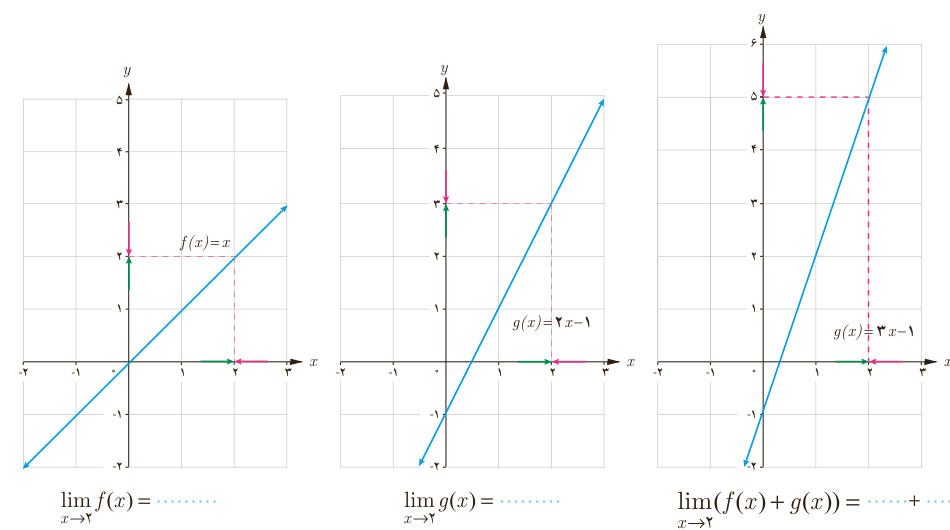

# درس دوم | محاسبه حد توابع

تاکنون برای محاسبه حد یک تابع بیشتر از جدول‌ها و نمودارها بهره بردیم. در اینجا به کمک چند قانون، حد توابع را محاسبه می‌کنیم.

### ۳ـ حد مجموع

اگر $\lim_{x\to a}f(x)=l$ و $\lim_{x\to a}g(x)=m$ آنگاه:

$$\lim_{x\to a}(f(x)+g(x))=\lim_{x\to a}f(x)+\lim_{x\to a}g(x)=l+m$$

به عبارت دیگر اگر دو تابع در یک نقطه حد داشته باشند، حد مجموع دو تابع در آن نقطه برابر مجموع حدهای آنها در همان نقطه است.

### کار در کلاس

اگر $f(x)=x$ و $g(x)=2x-1$ آنگاه $\lim_{x\to2}(f(x)+g(x))$ را به کمک قانون بالا محاسبه کنید. جاهای خالی را پر کنید و به کمک نمودارها قانون حد مجموع را نیز توضیح دهید.

$$\lim_{x\to2}f(x)=\ldots\qquad\lim_{x\to2}g(x)=\ldots\qquad\lim_{x\to2}(f(x)+g(x))=\ldots+\ldots$$

### ۴ـ حد تفاضل

اگر $\lim_{x\to a}f(x)=l$ و $\lim_{x\to a}g(x)=m$ آنگاه:

$$\lim_{x\to a}(f(x)-g(x))=\lim_{x\to a}f(x)-\lim_{x\to a}g(x)=l-m$$

به عبارت دیگر اگر دو تابع در یک نقطه حد داشته باشند، حد تفاضل دو تابع در آن نقطه برابر تفاضل حدهای آنها در همان نقطه است.

۱۲۹
