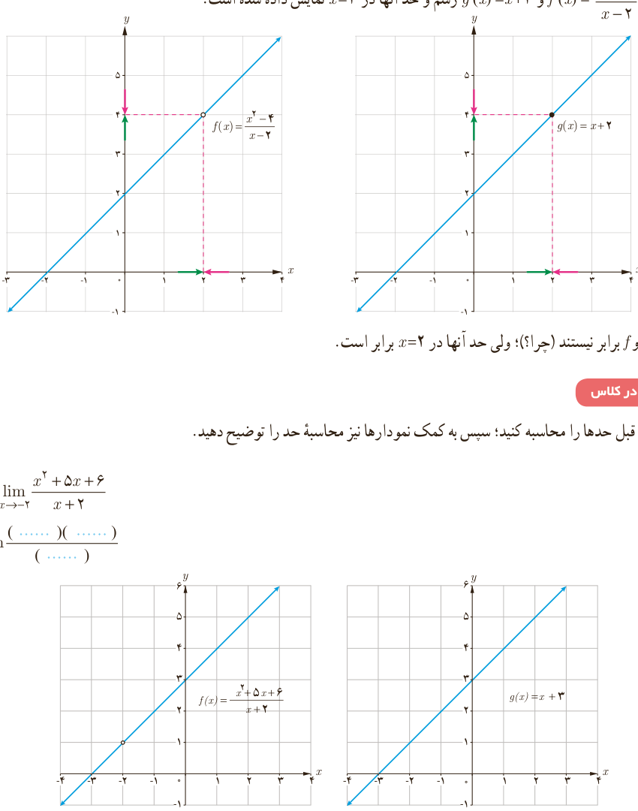

# فصل ۶ | حد و پیوستگی

مثال: $\lim_{x\to2}\frac{x^2-4}{x-2}$ را محاسبه کنید.

داریم: $\lim_{x\to2}(x-2)=\lim_{x\to2}(x^2-4)=0$،

$$\lim_{x\to2}\frac{x^2-4}{x-2}=\lim_{x\to2}\frac{(x+2)(x-2)}{x-2}=\lim_{x\to2}(x+2)=4$$

توجه داریم که وقتی $x$ به ۲ نزدیک می‌شود، $x\ne2$ پس $x-2\ne0$ و صورت و مخرج کسر را می‌توانیم بر $x-2$ تقسیم کنیم. در نمودارهای زیر توابع $f(x)=\frac{x^2-4}{x-2}$ و $g(x)=x+2$ رسم و حد آنها در $x=2$ نمایش داده شده است.

دو تابع $f$ و $g$ برابر نیستند (چرا؟)؛ ولی حد آنها در $x=2$ برابر است.

### کار در کلاس

مانند مثال قبل حدها را محاسبه کنید؛ سپس به کمک نمودارها نیز محاسبه حد را توضیح دهید.

الف) $\displaystyle\lim_{x\to-2}\frac{x^2+5x+6}{x+2}=\lim\frac{(\ldots)(\ldots)}{(\ldots)}$

۱۳۲
