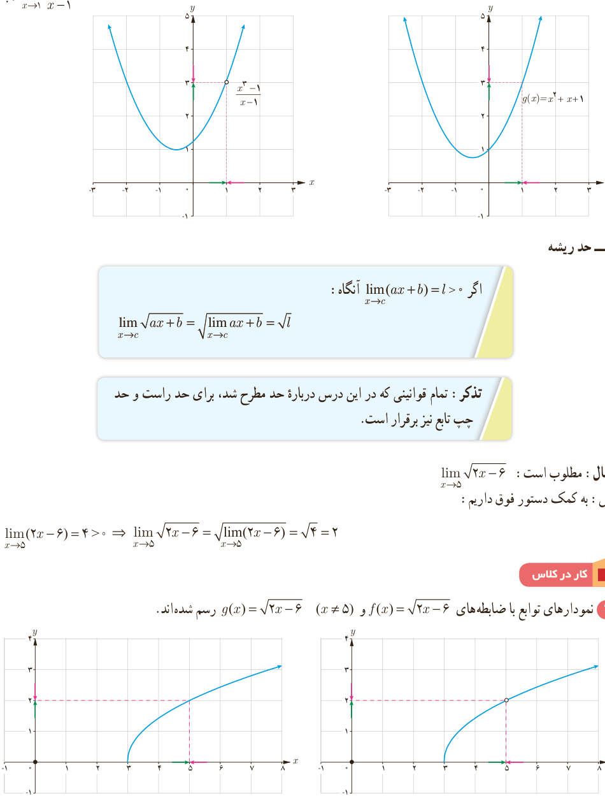

# درس دوم | محاسبه حد توابع

ب) $\displaystyle\lim_{x\to1}\frac{x^3-1}{x-1}$

### ۷ـ حد ریشه

اگر $\lim_{x\to c}(ax+b)=l>0$ آنگاه:

$$\lim_{x\to c}\sqrt{ax+b}=\sqrt{\lim_{x\to c}(ax+b)}=\sqrt l$$

**تذکر:** تمام قوانینی که در این درس درباره حد مطرح شد، برای حد راست و حد چپ تابع نیز برقرار است.

مثال: مطلوب است: $\lim_{x\to5}\sqrt{2x-6}$.

حل: به کمک دستور فوق داریم:

$$\lim_{x\to5}(2x-6)=4>0\Rightarrow\lim_{x\to5}\sqrt{2x-6}=\sqrt{\lim_{x\to5}(2x-6)}=\sqrt4=2$$

### کار در کلاس

۱) نمودارهای توابع با ضابطه‌های $f(x)=\sqrt{2x-6}$ و $g(x)=\sqrt{2x-6}$ ($x\ne5$) رسم شده‌اند.

۱۳۳
