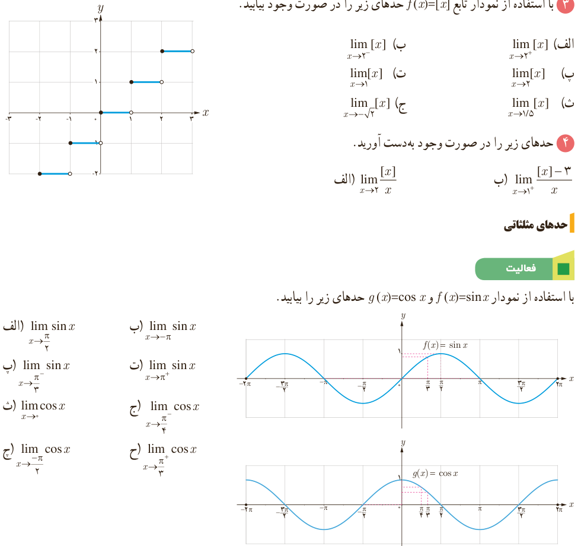

# فصل ۶ | حد و پیوستگی

الف) هر نمودار به کدام تابع تعلق دارد؟

ب) آیا $\lim_{x\to5}f(x)$ و $\lim_{x\to5}g(x)$ موجودند؟

پ) کدام یک از حدهای زیر موجودند؟ آنها را محاسبه کنید.

$$\lim_{x\to3}\sqrt{2x-6}=\ldots\qquad\lim_{x\to3^-}\sqrt{2x-6}=\ldots\qquad\lim_{x\to3^+}\sqrt{2x-6}=\ldots$$

۲) درباره تابع $h(x)=\frac{|x|}{x}$ درستی یا نادرستی گزاره‌های زیر را بررسی کنید.

الف) $h(x)=1$؛ ب) $D_h=\mathbb R-\{0\}$؛ پ) $\lim_{x\to0^+}h(x)=1$؛ ت) $h(0)=0$؛ ث) $\lim_{x\to0}h(x)$ وجود ندارد.

۳) با استفاده از نمودار تابع $f(x)=[x]$ حدهای زیر را در صورت وجود بیابید.

الف) $\lim_{x\to2^+}[x]$؛ ب) $\lim_{x\to2^-}[x]$؛ پ) $\lim_{x\to2}[x]$؛ ت) $\lim_{x\to1}[x]$؛ ث) $\lim_{x\to1.5}[x]$؛ ج) $\lim_{x\to-\sqrt2}[x]$.

۴) حدهای زیر را در صورت وجود به‌دست آورید.

الف) $\lim_{x\to2}\frac{[x]}x$؛ ب) $\lim_{x\to1^+}\frac{[x]-3}{x}$.

## حدهای مثلثاتی

### فعالیت

با استفاده از نمودار $f(x)=\sin x$ و $g(x)=\cos x$ حدهای زیر را بیابید.

الف) $\lim_{x\to\pi/2}\sin x$؛ ب) $\lim_{x\to-\pi}\sin x$؛ پ) $\lim_{x\to\pi/3^-}\sin x$؛ ت) $\lim_{x\to\pi^+}\sin x$؛ ث) $\lim_{x\to0}\cos x$؛ ج) $\lim_{x\to\pi/4}\cos x$؛ چ) $\lim_{x\to-\pi/2}\cos x$؛ ح) $\lim_{x\to\pi/3^+}\cos x$.

۱۳۴
