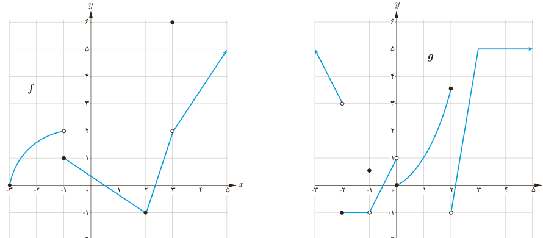

# درس دوم | محاسبه حد توابع

به‌طور کلی داریم:

$$\lim_{x\to\alpha}\sin x=\sin\alpha,\qquad\lim_{x\to\alpha}\cos x=\cos\alpha$$

مثال: به کمک دستورهایی که در این درس آموخته‌اید، حدهای زیر را در صورت وجود محاسبه کنید.

الف) $\lim_{x\to0}\frac{\cos x}{2+\sin x}$؛ ب) $\lim_{x\to\pi}\frac{\sin x\cos x}{1+\cos^2x}$.

حل:

الف) $\displaystyle\lim_{x\to0}\frac{\cos x}{2+\sin x}=\frac{\lim_{x\to0}\cos x}{\lim_{x\to0}(2+\sin x)}=\frac12$

ب) $\displaystyle\lim_{x\to\pi}\frac{\sin x\cos x}{1+\cos^2x}=\frac{\lim_{x\to\pi}(\sin x\cos x)}{\lim_{x\to\pi}(1+\cos^2x)}=\frac{0(-1)}2=0$

### تمرین

۱) با استفاده از قوانین حد و نمودارهای $f$ و $g$ حدهای زیر را (در صورت وجود) به‌دست آورید.

الف) $\lim_{x\to3}f(x)$؛ ب) $\lim_{x\to-1}f(x)$؛ پ) $\lim_{x\to3}g(x)$؛ ت) $\lim_{x\to3}(f(x)+g(x))$؛ ث) $\lim_{x\to-1}(f(x)+g(x))$؛ ج) $\lim_{x\to2}(2f(x)+5g(x))$؛ چ) $\lim_{x\to0}(f(x))^4$؛ ح) $\lim_{x\to0}(g(x))^2$؛ خ) $\lim_{x\to2}\frac{f(x)}{g(x)}$؛ د) $\lim_{x\to5}(f(x)g(x))$.

۱۳۵
