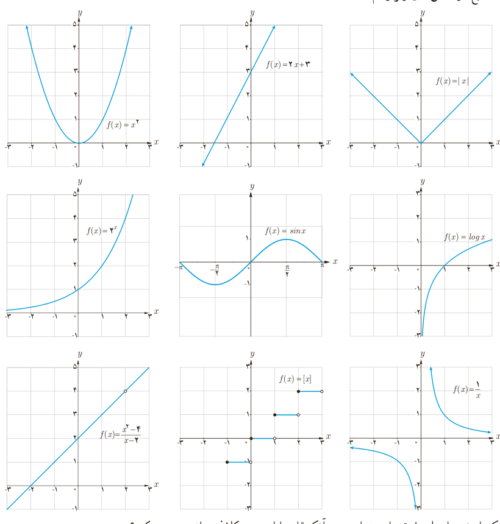

# درس سوم | پیوستگی

یکی از مفاهیم مهم در مبحث حد توابع، مفهوم پیوستگی است که در این درس با آن آشنا می‌شوید.

### فعالیت

نمودارهای نه تابع در شکل‌های زیر رسم شده‌اند.

الف) کدام یک از نمودارهای فوق را می‌توان بدون آنکه قلم را از روی کاغذ برداشت، رسم کرد؟

ب) مثال دیگری مشابه توابع بالا ارائه کنید.

ردیف‌های اول و دوم نمونه‌ای از توابع پیوسته هستند.

۱۳۷
