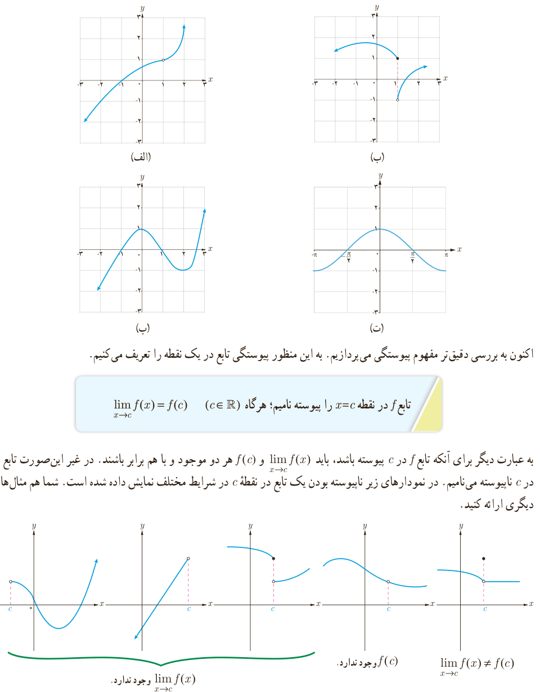

# فصل ۶ | حد و پیوستگی

مثال: تابع‌های داده شده با نمودارهای الف و ب پیوسته نیستند، ولی توابع با نمودارهای پ و ت پیوسته‌اند.

اکنون به بررسی دقیق‌تر مفهوم پیوستگی می‌پردازیم. به این منظور پیوستگی تابع در یک نقطه را تعریف می‌کنیم.

تابع $f$ در نقطه $x=c$ را پیوسته نامیم؛ هرگاه ($c\in\mathbb R$):

$$\lim_{x\to c}f(x)=f(c)$$

به عبارت دیگر برای آنکه تابع $f$ در $c$ پیوسته باشد، باید $\lim_{x\to c}f(x)$ و $f(c)$ هر دو موجود و با هم برابر باشند. در غیر این‌صورت تابع را در $c$ ناپیوسته می‌نامیم. در نمودارهای زیر ناپیوسته بودن یک تابع در نقطه $c$ در شرایط مختلف نمایش داده شده است. شما هم مثال‌های دیگری ارائه کنید.

۱۳۸
