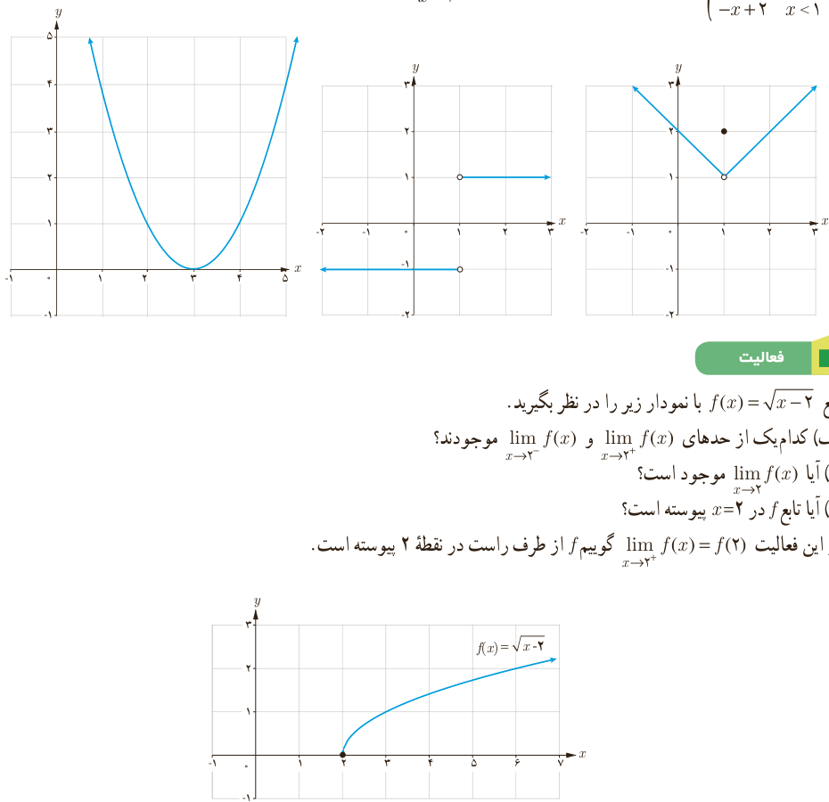

# درس سوم | پیوستگی

### کار در کلاس

کدام یک از توابع زیر با ضابطه‌های داده شده در $x=1$ ناپیوسته‌اند؟

الف) $f(x)=(x-3)^2$؛ ب) $g(x)=\frac{|x-1|}{x-1}$؛ پ) $h(x)=\begin{cases}x&x>1\\2&x=1\\-x+2&x<1\end{cases}$.

### فعالیت

تابع $f(x)=\sqrt{x-2}$ با نمودار زیر را در نظر بگیرید.

الف) کدام یک از حدهای $\lim_{x\to2^+}f(x)$ و $\lim_{x\to2^-}f(x)$ موجودند؟

ب) آیا $\lim_{x\to2}f(x)$ موجود است؟

پ) آیا تابع $f$ در $x=2$ پیوسته است؟

در این فعالیت $\lim_{x\to2^+}f(x)=f(2)$ گوییم $f$ از طرف راست در نقطه ۲ پیوسته است.

تابع $f$ را در $x=c$ از طرف راست پیوسته می‌نامیم؛ هرگاه $\lim_{x\to c^+}f(x)=f(c)$. در این صورت می‌گوییم $f$ در $x=c$ پیوستگی راست دارد.

۱۳۹
