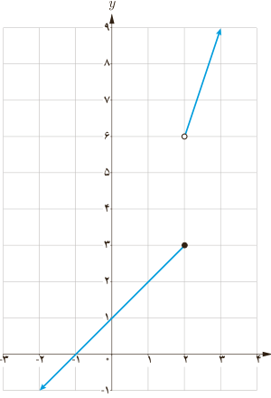

# فصل ۶ | حد و پیوستگی

### کار در کلاس

تابع با ضابطه $g(x)=\begin{cases}3x&x>2\\x+1&x\leq2\end{cases}$ و نمودار آن را در نظر بگیرید.

الف) کدام یک از حدهای $\lim_{x\to2^+}g(x)$ و $\lim_{x\to2^-}g(x)$ موجودند؟

ب) آیا $\lim_{x\to2}g(x)$ موجود است؟

پ) آیا تابع $g$ در $x=2$ پیوسته است؟

برای تابع $g(x)$، $\lim_{x\to2^-}g(x)=g(2)$، گوییم $g$ از طرف چپ در نقطه ۲ پیوسته است.

تابع $f$ را در $x=c$ از طرف چپ پیوسته می‌نامیم، هرگاه $\lim_{x\to c^-}f(x)=f(c)$. در این صورت گوییم $f$ در $x=c$ پیوستگی چپ دارد.

با توجه به تعریف معلوم است که $f$ در $x=c$ پیوسته است، هرگاه $f$ در $c$ هم پیوستگی راست و هم پیوستگی چپ داشته باشد.

مثال: الف) تابع $f(x)=[x]$ در $x=2$ پیوستگی راست دارد. تابع $f(x)=[x]$ در $x=2$ پیوسته نیست.

ب) تابع $f(x)=\begin{cases}x^2&x\leq0\\2x+3&x>0\end{cases}$ در نقطه ۰ پیوستگی چپ دارد. تابع $f$ در $x=0$ پیوسته نیست.

پ) تابع $g(x)=\begin{cases}-x+3&x<1\\2x&x\geq1\end{cases}$ در $x=1$ پیوسته است.

## پیوستگی روی یک بازه

تابع $f$ روی بازه $(a,b)$ پیوسته است؛ هرگاه، در هر نقطه این بازه پیوسته باشد.

تابع $f$ روی بازه $[a,b]$ پیوسته است؛ هرگاه $f$ در بازه $(a,b)$ پیوسته باشد و در نقطه $a$ پیوسته راست و در نقطه $b$ پیوسته چپ باشد.

### کار در کلاس

پیوستگی روی بازه‌های $[a,b)$ و $(a,b]$ را به طور مشابه تعریف کنید.

تابع $f$ روی بازه $[a,b)$ پیوسته است هرگاه ........

در این حالت اگر $b=+\infty$، یعنی تابع $f$ در $a$ پیوستگی راست دارد و در تمام نقاط بزرگ‌تر از $a$ پیوسته است.

تابع $f$ روی بازه $(a,b]$ پیوسته است هرگاه ........

در این حالت اگر $a=-\infty$، یعنی تابع $f$ در $b$ پیوستگی چپ دارد و در تمام نقاط کوچک‌تر از $b$ پیوسته است.

۱۴۰
