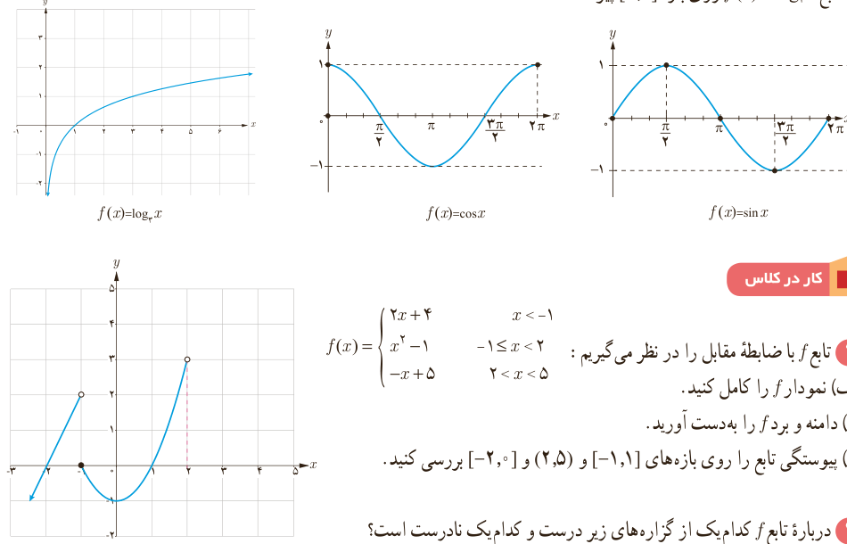

# درس سوم | پیوستگی

اگر $D_f=\mathbb R$ و $f$ در هر نقطه از دامنه‌اش پیوسته باشد، می‌گوییم $f$ روی بازه $(-\infty,+\infty)$ پیوسته است.

### کار در کلاس

سه تابع متفاوت مثال بزنید که:

الف) روی بازه $(-\infty,\infty)$ پیوسته باشد. ب) روی بازه $[-2,+\infty)$ پیوسته باشد. پ) روی بازه $(-\infty,0]$ پیوسته باشد.

مثال: الف) اگر $f$ یک تابع چندجمله‌ای باشد، آنگاه $f$ روی بازه $(-\infty,\infty)$ پیوسته است؛ زیرا $\lim_{x\to c}f(x)=f(c)$ ($c\in\mathbb R$).

ب) توابع $f(x)=\sin x$ و $g(x)=\cos x$ روی بازه‌های $(-\infty,\infty)$ پیوسته‌اند.

پ) تابع $f(x)=\log_2x$ روی بازه $(0,\infty)$ پیوسته است.

ت) اگر تابعی روی بازه‌ای پیوسته باشد، روی هر زیر بازه دلخواه از آن نیز پیوسته است.

ث) توابع $f(x)=\sin x$ و $g(x)=\cos x$ روی بازه‌های $[0,2\pi]$ پیوسته‌اند.

ج) تابع $f(x)=\log_2x$ روی بازه $[1,2]$ پیوسته است.

### کار در کلاس

۱) تابع $f$ با ضابطه مقابل را در نظر می‌گیریم:

$$f(x)=\begin{cases}2x+4&x<-1\\x^2-1&-1\leq x<2\\-x+5&2<x<5\end{cases}$$

الف) نمودار $f$ را کامل کنید. ب) دامنه و برد $f$ را به‌دست آورید. پ) پیوستگی تابع را روی بازه‌های $[-1,1]$ و $(2,5)$ و $[-2,0]$ بررسی کنید.

۲) درباره تابع $f$ کدام یک از گزاره‌های زیر درست و کدام یک نادرست است؟

الف) $f$ روی بازه $(-\infty,-1]$ پیوسته است. ب) $f$ روی بازه $(-\infty,-1)$ پیوسته است. پ) $f$ روی بازه $[2,5]$ پیوسته است. ت) $\lim_{x\to5}f(x)=0$. ث) $\lim_{x\to5^-}f(x)=0$. ج) $f$ روی بازه $(-2,0)$ پیوسته است.

۱۴۱
