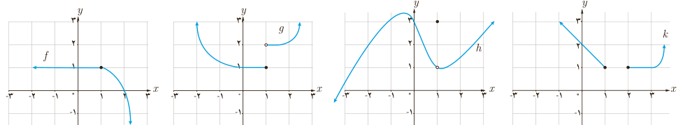

# فصل ۶ | حد و پیوستگی

۳) با توجه به تابع $f$:

الف) دو بازه بسته مثال بزنید که تابع در یکی از آنها پیوسته و در دیگری ناپیوسته باشد.

ب) $a$ و $b$ای را مثال بزنید که تابع روی $[a,b)$ پیوسته باشد؛ اما روی $[a,b]$ پیوسته نباشد.

### تمرین

۱) با توجه به توابع $f$ و $g$ و $h$ با ضابطه‌های داده شده، به سؤالات پاسخ دهید.

$$f(x)=2x+1,\quad g(x)=2x+1\quad x\ne2,\quad h(x)=\begin{cases}2+x&x\ne2\\3&x=2\end{cases}$$

الف) مقادیر زیر را در صورت وجود به دست آورید: $f(2)=$، $g(2)=$، $h(2)=$.

ب) حدود زیر را در صورت وجود به‌دست آورید: $\lim_{x\to2}f(x)$، $\lim_{x\to2}g(x)$، $\lim_{x\to2}h(x)$.

پ) کدام تابع در $x=2$ پیوسته است؟

۲) نمودار تابع $f(x)=\begin{cases}x-3&x<2\\-2&x=2\\-x+2&x>2\end{cases}$ را رسم کنید. $f$ در چه نقاطی پیوسته و در چه نقاطی ناپیوسته است؟

۳) توابع $f(x)=\begin{cases}\frac{x^2-9}{x-3}&x\ne3\\6&x=3\end{cases}$ و $g(x)=\frac{x^2-9}{x-3}$ را در نظر می‌گیریم. پیوستگی این تابع‌ها را در $x=3$ بررسی کنید.

۴) با توجه به نمودار تابع $f(x)=[x]$، تابع در چه نقاطی پیوسته و در چه نقاطی ناپیوسته است؟

۵) پیوستگی تابع $f(x)=\begin{cases}-2x+2&x\leq0\\x^2+2&x>0\end{cases}$ را در نقطه $x=0$ بررسی کنید. پیوستگی تابع در نقاط دیگر چگونه است؟

۶) تابعی مثال بزنید که حد آن در نقطه $x=1$ مساوی ۱− باشد؛ ولی تابع در ۱ پیوسته نباشد. نمودار این تابع را رسم کنید.

۷) کدام یک از توابع زیر در $x=1$ پیوسته است؟

۸) در مواقعی تجویز دارو برای کودکان بر اساس جرم کودک انجام می‌گیرد. روش‌های مختلفی برای برآورد کردن جرم یک کودک (برحسب کیلوگرم) در شرایط اضطراری (که جرم نمی‌تواند اندازه‌گیری شود) وجود دارد. یکی از این روش‌ها استفاده از تابع $f(t)=\begin{cases}6t+4&0\leq t<1\\2t+10&1\leq t\leq10\end{cases}$ است که در آن $t$ سن کودک برحسب سال است. به‌طور مثال جرم یک کودک ۶ ماهه به کمک این تابع چنین محاسبه می‌شود:

۶ ماه $\to\frac6{12}=\frac12$ سال، $f(\frac12)=6\times(\frac12)+4=7$.

الف) $f(2)$ و $f(5)$ را بیابید. ب) آیا $f$ در بازه $[0,10]$ پیوسته است؟

۱۴۲
