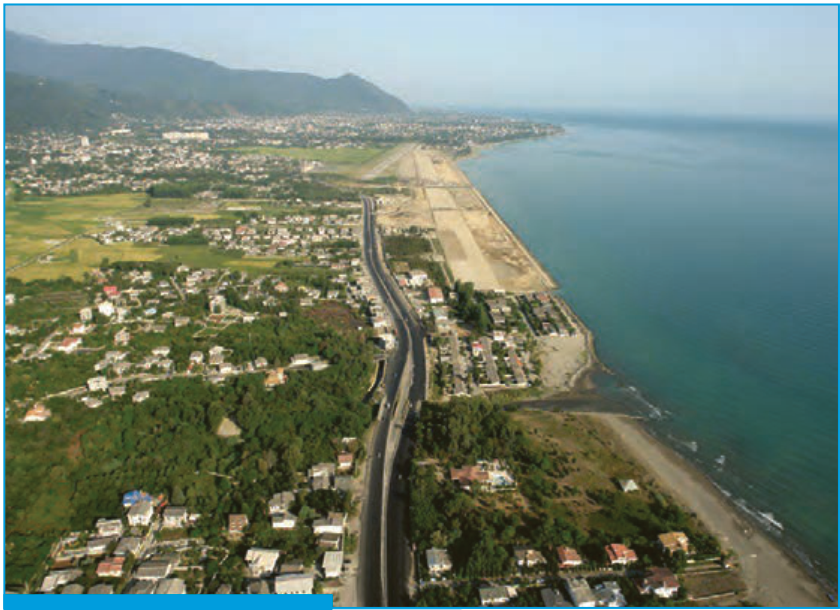

# فصل ۷ | آمار و احتمال

امروزه نقش روزافزون آمار و احتمال در حل مسائل زندگی بر کسی پوشیده نیست. یکی از کاربردهای مهم آمار و احتمال، پیش‌بینی وضع هواست. با پیشرفت روش‌های علمی، احتمال پیش‌بینی درست آب‌وهوا به‌طور چشمگیری افزایش یافته است.

- درس اول: احتمال شرطی و پیشامدهای مستقل
- درس دوم: آمار توصیفی
