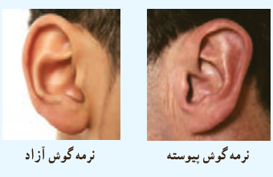

# فصل ۷ | آمار و احتمال

وقوع پیشامد $B$ احتمال وقوع پیشامد $A$ را تغییر نداده است. بنابراین در این حالت $A$ و $B$ مستقل از یکدیگرند.

پ) در صورتی که عدد رو شده در تاس اول ۲ باشد، در هیچ حالتی مجموع دو تاس ۱۰ نمی‌شود. بنابراین در این حالت احتمال اینکه مجموع دو تاس برابر ۱۰ شود، صفر است. لذا در این حالت وقوع پیشامد $B$ احتمال وقوع پیشامد $A$ را از $\frac1{12}$ به صفر کاهش داده است.

پس در این حالت $A$ و $B$ مستقل نیستند.

### خواندنی

عوامل ژنتیک در شکل‌گیری صفات انسان نقش دارند و از والدین به فرزندان منتقل می‌شوند. آیا تاکنون دقت کرده‌اید که نرمه گوش انسان می‌تواند دو حالت داشته باشد، یکی پیوسته و یکی آزاد؟ با توجه به این موضوع سؤال‌هایی از این قبیل می‌توانند مطرح باشند:

اگر مردی نرمه گوش آزاد و همسرش نرمه گوش پیوسته داشته باشد، آیا می‌توان پیش‌بینی کرد که فرزند آنها چه نوع نرمه گوشی خواهد داشت؟ در ادامه به کمک علم احتمال به مسئله بالا می‌پردازیم.

مثال: در علم ژنتیک برای ایجاد برخی صفات در فرزندان دو عامل را مؤثر می‌دانند که یکی از پدر و یکی از مادر به ارث می‌رسد. فرض کنیم این دو عامل را که در تعیین شکل نرمه گوش فرزند مؤثرند با $A$ و $a$ نمایش دهیم که در آن:

$A$: عامل به وجود آمدن نرمه گوش آزاد؛ $a$: عامل به وجود آمدن نرمه گوش پیوسته.

بنابراین هر فرد به یکی از حالت‌های $AA$ یا $aa$ یا $Aa$ می‌تواند باشد که با احتمال $\frac12$ هر یک از آنها را به فرزند خود می‌تواند انتقال دهد و تأثیر آن بر نرمه گوش فرزند به صورت زیر است:

- اگر عامل‌های فرزند به صورت $AA$ باشد، این فرد دارای نرمه گوش آزاد است.
- اگر عامل‌های فرزند به صورت $aa$ باشد، این فرد دارای نرمه گوش پیوسته است.
- اگر عامل‌های فرزند به صورت $Aa$ باشد، این فرد دارای نرمه گوش آزاد است، به همین دلیل عامل $A$ را غالب و عامل $a$ را مغلوب می‌نامند. به‌طور خلاصه داریم:

| عامل‌های شخص | $AA$ | $Aa$ یا $aA$ | $aa$ |
|---|---|---|---|
| نوع نرمه گوش شخص | آزاد | آزاد | پیوسته |

به حالت‌های $AA$ و $aa$ خالص و به حالت $Aa$ ناخالص می‌گوییم. در شکل‌های صفحه بعد حالت‌های مختلف انتقال عوامل از پدر و مادر به فرزند نمایش داده شده‌اند.

۱۵۰
