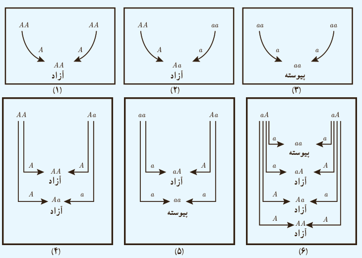

# درس اول | احتمال شرطی و پیشامدهای مستقل

فرض کنیم احتمال هر یک از دو عامل هر فرد به فرزندش $\frac12$ باشد. اگر از میان افراد یک جامعه آماری که نرمه گوش آزاد دارند، ۵۰ درصدشان خالص و ۵۰ درصدشان ناخالص باشند، هر یک از احتمال‌های زیر را محاسبه کنید.

اگر علی نرمه گوش آزاد و همسرش نرمه گوش پیوسته داشته باشد، و آنها یک فرزند با نرمه گوش پیوسته داشته باشند، با چه احتمالی نرمه گوش فرزند دوم آنها پیوسته خواهد بود؟

حل: از آنجا که پدر، نرمه گوش آزاد دارد، عامل‌های او به صورت $AA$ یا $Aa$ است. اما اگر عامل‌های پدر به صورت $AA$ باشد، نرمه گوش فرزندان آنها به صورت آزاد خواهد بود. بنابراین عامل‌های پدر به صورت $Aa$ است. از طرفی از آنجا که مادر نرمه گوش پیوسته دارد، لذا عامل‌های او به صورت $aa$ خواهد بود. بنابراین با توجه به شکل ۵ با احتمال $\frac12$، فرزند دوم آنها نرمه گوش پیوسته خواهد داشت.

### تمرین

۱) در پرتاب یک تاس فرض کنید پیشامد $A$ ظاهر شدن عدد زوج، پیشامد $B$ ظاهر شدن عددی مضرب ۳ و پیشامد $C$ ظاهر شدن عددی بزرگ‌تر از ۲ باشد. مستقل یا غیرمستقل بودن هر دو پیشامد را بررسی کنید.

۲) یک سکه را سه بار پرتاب می‌کنیم. احتمال رو آمدن سکه در پرتاب سوم را به‌دست آورید، به شرط اینکه در دو پرتاب اول و دوم، پشت ظاهر شده باشد.

۳) فرض کنید $A$ و $B$ دو پیشامد ناتهی و مستقل از یکدیگرند.

الف) نشان دهید $A'$ و $B$ مستقل‌اند.

ب) با توجه به (الف) نشان دهید $A'$ و $B'$ نیز مستقل‌اند.

۱۵۱
