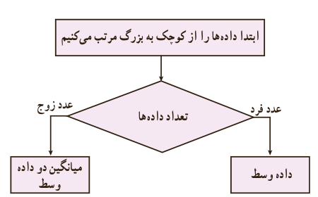

# فصل ۷ | آمار و احتمال

میانگین جرم دوستان محمد برابر است با ........ .

## ویژگی‌های میانگین

اگر هر یک از داده‌های آماری با مقدار ثابتی جمع شود، میانگین آنها نیز با همان مقدار ثابت جمع خواهد شد. چرا؟

اگر هر یک از داده‌های آماری در مقدار ثابتی ضرب شود، میانگین آنها نیز در همان مقدار ثابت ضرب خواهد شد. چرا؟

### کار در کلاس

۱) در فعالیت قبل، میانگین جرم دوستان محمد چند گرم است؟

۲) هوای اهواز در هر ساعت از یک روز بهاری گزارش شد. اگر میانگین دمای هوا ۲۸ درجه سانتی‌گراد باشد، میانگین دمای هوا چند درجه فارنهایت است؟ (راهنمایی $F=\frac95C+32$)

### میانه

پس از مرتب کردن داده‌ها، مقداری را که تعداد داده‌های بعد از آن با تعداد داده‌های قبل از آن برابر است میانه می‌نامیم و آن را با $Q_2$ نمایش می‌دهیم.

مثال: در فعالیت قبل، میانه داده‌ها کدام است؟

محمد برای پاسخ به این سؤال:

الف) داده‌ها را از کوچک به بزرگ مرتب کرد: ۵۵، ۵۵، ۵۷، ۶۱، ۶۲.

ب) جرم رضا و احمد از سام کمتر است. در حالی که جرم علی و نیما از سام بیشتر است.

در مثال فوق، عدد ۵۷ را میانه داده‌ها می‌نامند، زیرا پس از مرتب کردن داده‌ها از کوچک به بزرگ، در وسط داده‌ها قرار می‌گیرد.

روش محاسبه میانه:

۱۵۴
