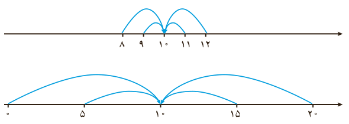

# فصل ۷ | آمار و احتمال

### فعالیت

نمره درس ریاضی دانش‌آموزان دو کلاس $A$ و $B$، به تفکیک گزارش شده است:

| کلاس | نمره‌ها |
|---|---|
| $A$ | ۸، ۹، ۱۰، ۱۱، ۱۲ |
| $B$ | ۰، ۵، ۱۰، ۱۵، ۲۰ |

الف) میانه نمره این دو کلاس را محاسبه کنید.

ب) میانگین نمره این دو کلاس را محاسبه کنید.

پ) به نظر شما یک معلم ریاضی ترجیح می‌دهد در کدام کلاس تدریس کند؟ چرا؟

همان‌طور که در فعالیت می‌بینید، تنها توجه به معیارهای گرایش به مرکز نمی‌تواند اطلاعات کاملی از داده‌ها در اختیار ما قرار دهد و لازم است به چگونگی پراکندگی داده‌ها نیز توجه شود.

### دامنه تغییرات

دامنه تغییرات ساده‌ترین شاخص پراکندگی است که اختلاف بین بزرگ‌ترین و کوچک‌ترین داده‌ها را نشان می‌دهد و آن را با نماد $R$ نمایش می‌دهیم.

مثال: در فعالیت بالا برای محاسبه دامنه تغییرات نمره ریاضی کلاس $A$ و کلاس $B$ به‌صورت زیر عمل کنید:

|  | کلاس $A$ | کلاس $B$ |
|---|---|---|
| کوچک‌ترین داده | ۸ | ۰ |
| بزرگ‌ترین داده | ۱۲ | ۲۰ |
| دامنه تغییرات | $12-8=4$ | $20-0=20$ |

در فعالیت بالا دامنه تغییرات نمره ریاضی کلاس $A$، ۴ نمره و دامنه تغییرات نمره ریاضی کلاس $B$، ۲۰ نمره است. ملاحظه می‌شود که در کلاس $A$ پراکندگی داده‌ها کمتر از کلاس $B$ است.

۱۵۶
