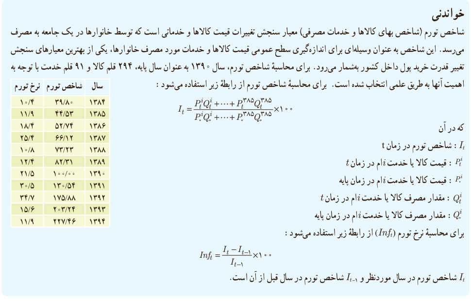

# درس دوم | آمار توصیفی

۵) میانگین، میانه و انحراف معیار نرخ تورم (مراجعه به خواندنی) سال‌های ۸۴–۹۴ را بر اساس جدول زیر محاسبه کنید.

| سال | ۱۳۸۴ | ۱۳۸۵ | ۱۳۸۶ | ۱۳۸۷ | ۱۳۸۸ | ۱۳۸۹ | ۱۳۹۰ | ۱۳۹۱ | ۱۳۹۲ | ۱۳۹۳ | ۱۳۹۴ |
|---|---|---|---|---|---|---|---|---|---|---|---|
| نرخ تورم | ۱۰٫۴ | ۱۱٫۹ | ۱۸٫۴ | ۲۵٫۴ | ۱۰٫۸ | ۱۲٫۴ | ۲۱٫۵ | ۳۰٫۵ | ۳۴٫۷ | ۱۵٫۶ | ۱۱٫۹ |

۶) در جدول زیر، ارتفاع از سطح دریا برای بعضی از شهرهای استان مرکزی و کهگیلویه و بویراحمد دیده می‌شود. (راهنمایی: $1m=3.281ft$، $ft$: فوت، $m$: متر)

| استان | شهر | ارتفاع از سطح دریا |
|---|---|---|
| مرکزی | اراک | ۱۷۰۸ متر |
| مرکزی | محلات | ۱۷۷۵ متر |
| مرکزی | خمین | ۱۸۳۰ متر |
| مرکزی | شازند | ۱۹۲۰ متر |
| کهگیلویه و بویراحمد | یاسوج | ۶۱۳۵٫۴۷ فوت |
| کهگیلویه و بویراحمد | دهدشت | ۳۲۴۸٫۱۹ فوت |
| کهگیلویه و بویراحمد | دنا | ۷۲۱۸٫۲۰ فوت |

الف) میانگین ارتفاع از سطح دریا در شهرهای استان مرکزی چقدر است؟

ب) انحراف معیار ارتفاع از سطح دریا در شهرهای استان مرکزی چقدر است؟

پ) ارتفاع از سطح دریا برای شهرهای کدام استان بیشتر است؟

### خواندنی

شاخص تورم (شاخص بهای کالاها و خدمات مصرفی) معیار سنجش تغییرات قیمت کالاها و خدماتی است که توسط خانوارها در یک جامعه به مصرف می‌رسد. این شاخص به عنوان وسیله‌ای برای اندازه‌گیری سطح عمومی قیمت کالاها و خدمات مورد مصرف خانوارها، یکی از بهترین معیارهای سنجش تغییر قدرت خرید پول داخل کشور به‌شمار می‌رود. برای محاسبه شاخص تورم، سال ۱۳۹۰ به عنوان سال پایه، ۲۹۴ قلم کالا و ۹۱ قلم خدمت با توجه به اهمیت آنها به طریق علمی انتخاب شده است. برای محاسبه شاخص تورم از رابطه زیر استفاده می‌شود:

$$I_t=\frac{P_t^1Q_t^1+\cdots+P_t^{385}Q_t^{385}}{P_0^1Q_0^1+\cdots+P_0^{385}Q_0^{385}}\times100$$

که در آن $I_t$ شاخص تورم در زمان $t$؛ $P_t^i$ قیمت کالا یا خدمت $i$ام در زمان $t$؛ $P_0^i$ قیمت کالا یا خدمت $i$ام در زمان پایه؛ $Q_t^i$ مقدار مصرف کالا یا خدمت $i$ام در زمان $t$؛ و $Q_0^i$ مقدار مصرف کالا یا خدمت $i$ام در زمان پایه است.

برای محاسبه نرخ تورم ($Inf_t$) از رابطه زیر استفاده می‌شود:

$$Inf_t=\frac{I_t-I_{t-1}}{I_{t-1}}\times100$$

$I_t$ شاخص تورم در سال موردنظر و $I_{t-1}$ شاخص تورم در سال قبل از آن است.

۱۶۳
