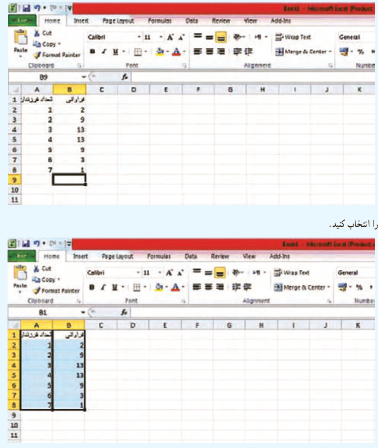

# فصل ۷ | آمار و احتمال

### خواندنی

در بسیاری از پژوهش‌ها برای بیان بهتر نتایج و انتقال ساده‌تر مفاهیم، از جدول‌ها و نمودارها استفاده می‌کنند. نرم‌افزارهای گوناگونی برای ترسیم نمودارها به کار گرفته می‌شوند. پرکاربردترین، ساده‌ترین و فراگیرترین نرم‌افزار موجود، برنامه اکسل از مجموعه مایکروسافت آفیس است.

نخستین مرحله از رسم نمودار، وارد کردن داده‌ها در یک کاربرگ (worksheet) از برنامه اکسل است. نام متغیرها را بالای ستون مربوط به آن بنویسید. معمولاً متغیر در ستون اول و فراوانی یا مقدار هر گروه یا متغیر را در ستون بعد روبه‌روی آن وارد می‌کنند. برنامه اکسل متغیر را به‌صورت خودکار، روی محور افقی و فراوانی یا مقادیر را روی محور عمودی نشان می‌دهد. انواع نمودارهای پیش‌فرض که در پایه‌های پیشین با آنها آشنا شده‌اید، در برنامه اکسل وجود دارد.

### نمودار میله‌ای

برای نمایش فراوانی یا درصد متغیرهای اسمی، گسسته یا گروه‌بندی شده از نمودار میله‌ای استفاده می‌شود. برای مثال تعداد فرزندان خانواده، داده گسسته است. برای رسم نمودار در اکسل داده‌ها را وارد کنید:

| تعداد فرزندان | فراوانی |
|---|---|
| ۱ | ۲ |
| ۲ | ۹ |
| ۳ | ۱۳ |
| ۴ | ۱۳ |
| ۵ | ۹ |
| ۶ | ۳ |
| ۷ | ۱ |

سپس دو ستون را انتخاب کنید.

۱۶۴
