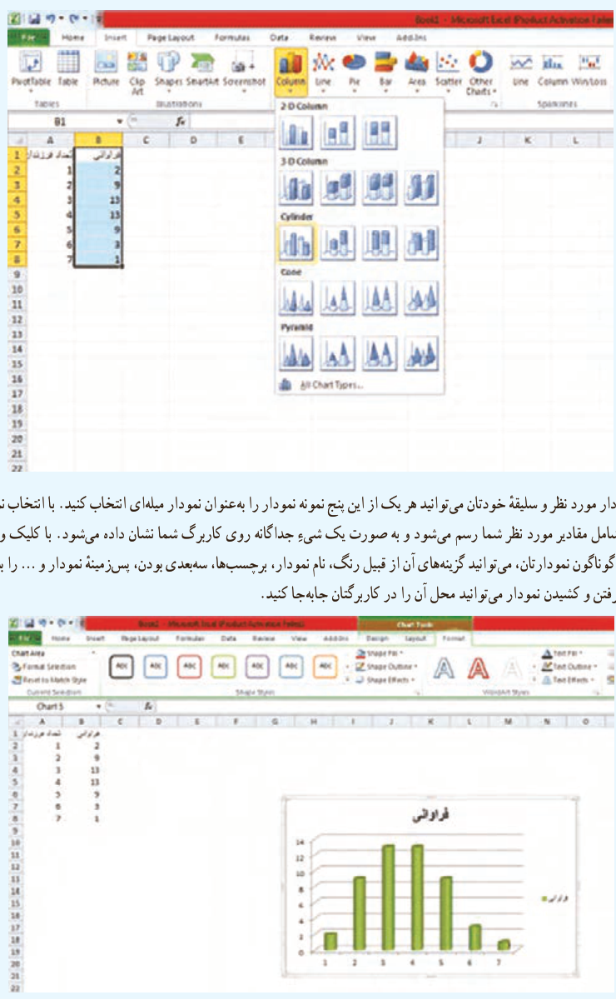

# درس دوم | آمار توصیفی

سپس از منوی صفحه قبل سربرگ Insert را انتخاب کنید. انواع نمودار را در آنجا می‌بینید. برای رسم نمودار میله‌ای، از الگوی Column یا Bar استفاده کنید.

بنا به کارایی نمودار مورد نظر و سلیقه خودتان می‌توانید هر یک از این پنج نمونه نمودار را به‌عنوان نمودار میله‌ای انتخاب کنید. با انتخاب نمودار موردنظر، نمودار میله‌ای شامل مقادیر مورد نظر شما رسم می‌شود و به صورت یک شیء جداگانه روی کاربرگ شما نشان داده می‌شود. با کلیک و راست‌کلیک بر روی بخش‌های گوناگون نمودارتان، می‌توانید گزینه‌های آن از قبیل رنگ، نام نمودار، برچسب‌ها، سه‌بعدی بودن، پس‌زمینه نمودار و ... را به اشکال مختلف تغییر دهید. با گرفتن و کشیدن نمودار می‌توانید محل آن را در کاربرگتان جابه‌جا کنید.

۱۶۵
