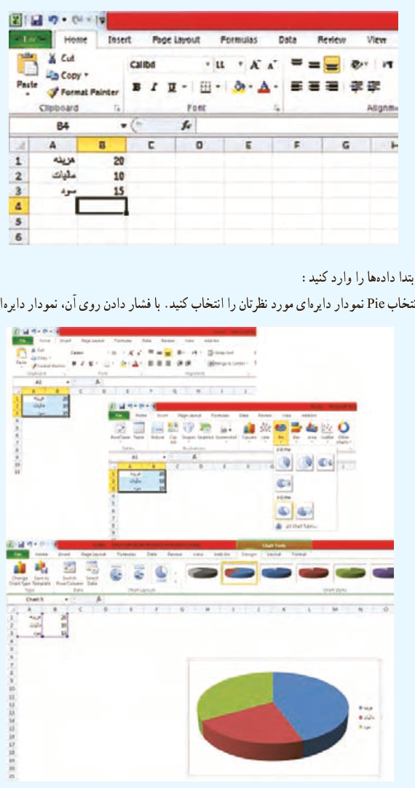

# فصل ۷ | آمار و احتمال

### نمودار دایره‌ای

نمودار دایره‌ای، بهتر است برای متغیر اسمی استفاده شود. هنگامی که یک موضوع را به بخش‌هایی تفکیک کنیم، نمودار دایره‌ای بسیار مناسب است؛ مثلاً درآمد یک شرکت به بخش‌های مختلف تعلق می‌گیرد. می‌توان آن را با نمودار دایره‌ای نمایش داد.

برای رسم نمودار در اکسل ابتدا داده‌ها را وارد کنید:

با رفتن به قسمت Insert و انتخاب Pie نمودار دایره‌ای مورد نظرتان را انتخاب کنید. با فشار دادن روی آن، نمودار دایره‌ای رسم می‌شود.

دیدید که برای رسم سایر نمودارها هم می‌توان به همین ترتیب عمل کرد، فقط کافی است از منوی بالا سربرگ Insert را انتخاب کنید و نمودار مورد نظر خود را، پس از ورود داده‌ها انتخاب نمایید.

۱۶۶
