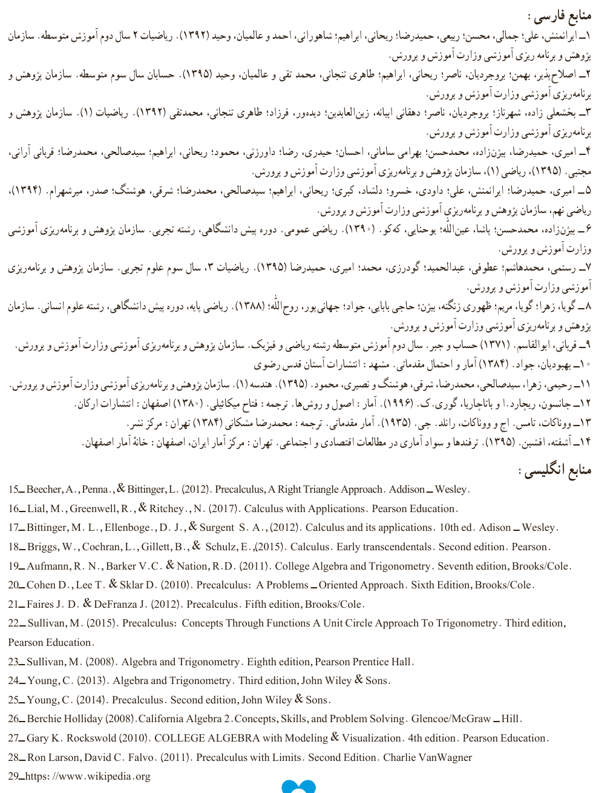

# منابع فارسی

۱– ایرانمنش، علی؛ جمالی، محسن؛ ربیعی، حمیدرضا؛ ریحانی، ابراهیم؛ شاهورانی، احمد و عالمیـان، وحید (۱۳۹۲). ریاضیات ۲ سال دوم آموزش متوسطه. سازمان پژوهش و برنامه‌ریزی آموزشی وزارت آموزش و پرورش.

۲– اصلاح‌پذیر، بهمن؛ بروجردیان، ناصر؛ ریحانی، ابراهیم؛ طاهری تنجانی، محمد تقی و عالمیـان، وحید (۱۳۹۵). حسابان سال سوم متوسطه. سازمان پژوهش و برنامه‌ریزی آموزشی وزارت آموزش و پرورش.

۳– بخشعلی‌زاده، شهناز؛ بروجردیان، ناصر؛ دهقانی ابهانه، زین‌العابدین؛ دیده‌ور، فرزاد؛ طاهری تنجانی، محمدتقی (۱۳۹۲). ریاضیات (۱). سازمان پژوهش و برنامه‌ریزی آموزشی وزارت آموزش و پرورش.

۴– امیری، حمیدرضا؛ بیزن‌زاده، محمدحسن؛ بهرامی سامانی، احسان؛ حیدری، رضا؛ داورزنی، محمود؛ ریحانی، ابراهیم؛ سیدصالحی، محمدرضا؛ قربانی آرانی، مجتبی (۱۳۹۵). ریاضی (۱). سازمان پژوهش و برنامه‌ریزی آموزشی وزارت آموزش و پرورش.

۵– امیری، حمیدرضا؛ ایرانمنش، علی؛ داودی، خسرو؛ دلشاد، کبری؛ ریحانی، ابراهیم؛ سیدصالحی، محمدرضا؛ شرقی، هوشنگ؛ صدر، میرشهـرام (۱۳۹۴). ریاضی نهم. سازمان پژوهش و برنامه‌ریزی آموزشی وزارت آموزش و پرورش.

۶– بیزن‌زاده، محمدحسن؛ پاشا، عین‌الله؛ یونانی، که‌کو (۱۳۹۰). ریاضی عمومی. دوره پیش دانشگاهی، رشته تجربی. سازمان پژوهش و برنامه‌ریزی آموزشی وزارت آموزش و پرورش.

۷– رستمی، محمدهاشم؛ عطوفی، عبدالحمید؛ گودرزی، محمد؛ امیری، حمیدرضا (۱۳۹۵). ریاضیات ۳، سال سوم علوم تجربی. سازمان پژوهش و برنامه‌ریزی آموزشی وزارت آموزش و پرورش.

۸– گویا، زهرا؛ گویا، مریم؛ ظهوری زنگنه، پروین؛ حاجی بابایی، جواد؛ جهان‌پور، روح‌الله (۱۳۸۸). ریاضی پایه، دوره پیش دانشگاهی، رشته علوم انسانی. سازمان پژوهش و برنامه‌ریزی آموزشی وزارت آموزش و پرورش.

۹– قربانی، ابوالقاسم (۱۳۷۱). حساب و جبر. سال دوم آموزش متوسطه رشته ریاضی و فیزیک. سازمان پژوهش و برنامه‌ریزی آموزشی وزارت آموزش و پرورش.

۱۰– بهبودیان، جواد (۱۳۸۴). آمار و احتمال مقدماتی. مشهد: انتشارات آستان قدس رضوی.

۱۱– رحیمی، زهرا؛ سیدصالحی، محمدرضا؛ شرقی، هوشنگ و نصیری، محمود (۱۳۹۵). هندسه (۱). سازمان پژوهش و برنامه‌ریزی آموزشی وزارت آموزش و پرورش.

۱۲– جانسون، ریچارد. ا و بهاچاریا، گوری. ک. (۱۹۹۶). آمار: اصول و روش‌ها. ترجمه: فلاح میکائیلی (۱۳۸۰) اصفهان: انتشارات ارکان.

۱۳– ووناکات، تامس. اچ و ووناکات، راندل. جی. (۱۹۳۵). آمار مقدماتی. ترجمه: محمدرضا مشکانی (۱۳۸۴) تهران: مرکز نشر.

۱۴– آشفته، افشین (۱۳۹۵). ترفندها و سواد آماری در مطالعات اقتصادی و اجتماعی. تهران: مرکز آمار ایران، اصفهان: خانه آمار اصفهان.

# منابع انگلیسی

15– Beecher, A., Penna., & Bittinger, L. (2012). Precalculus, A Right Triangle Approach. Addison–Wesley.
16– Lial, M., Greenwell, R., & Ritchey., N. (2017). Calculus with Applications. Pearson Education.
17– Bittinger, M. L., Ellenboge., D. J., & Surgent S. A., (2012). Calculus and its applications. 10th ed. Addison–Wesley.
18– Briggs, W., Cochran, L., Gillett, B., & Schulz, E., (2015). Calculus. Early transcendentals. Second edition. Pearson.
19– Aufmann, R. N., Barker V.C. & Nation, R.D. (2011). College Algebra and Trigonometry. Seventh edition, Brooks/Cole.
20– Cohen D., Lee T. & Sklar D. (2010). Precalculus: A Problems–Oriented Approach. Sixth Edition, Brooks/Cole.
21– Faires J. D. & DeFranza J. (2012). Precalculus. Fifth edition, Brooks/Cole.
22– Sullivan, M. (2015). Precalculus: Concepts Through Functions A Unit Circle Approach To Trigonometry. Third edition, Pearson Education.
23– Sullivan, M. (2008). Algebra and Trigonometry. Eighth edition, Pearson Prentice Hall.
24– Young, C. (2013). Algebra and Trigonometry. Third edition, John Wiley & Sons.
25– Young, C. (2014). Precalculus. Second edition, John Wiley & Sons.
26– Berchie Holliday (2008). California Algebra 2. Concepts, Skills, and Problem Solving. Glencoe/McGraw–Hill.
27– Gary K. Rockswold (2010). COLLEGE ALGEBRA with Modeling & Visualization. 4th edition. Pearson Education.
28– Ron Larson, David C. Falvo. (2011). Precalculus with Limits. Second Edition. Charlie VanWagner.
29– https://www.wikipedia.org

۱۶۷
