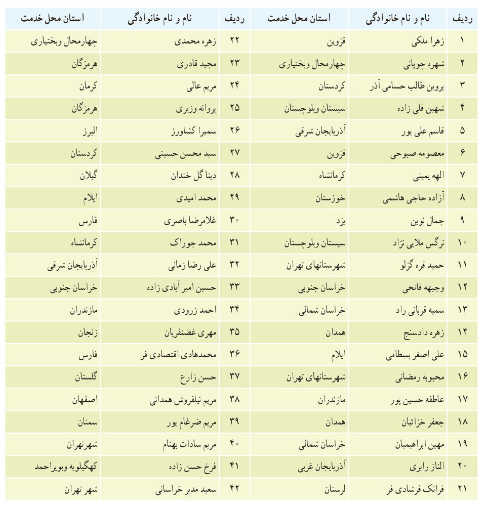

سازمان پژوهش و برنامه‌ریزی آموزشی جهت ایفای نقش خطیر خود در اجرای سند تحول بنیادین در آموزش و پرورش و برنامه درسی ملی جمهوری اسلامی ایران، مشارکت معلمان را به‌عنوان یک سیاست اجرایی مهم دنبال می‌کند. برای تحقق این امر در اقدامی نوآورانه سامانه تعاملی بر خط اعتبارسنجی کتاب‌های درسی راه‌اندازی شد تا با دریافت نظرات معلمان درباره کتاب‌های درسی نونگاشت، کتاب‌های درسی را در اولین سال چاپ، با کمترین اشکال به دانش‌آموزان و معلمان ارجمند تقدیم نماید. در انجام مطلوب این فرایند، همکاران گروه تحلیل محتوای آموزشی و پرورشی استان‌ها، گروه‌های آموزشی و دبیرخانه راهبری دروس و مدیریت محترم پروژه آقای محسن پاهو نقش سازنده‌ای را بر عهده داشتند. ضمن ارج نهادن به تلاش تمامی این همکاران، اسامی دبیران و هنرآموزانی که تلاش مضاعفی را در این زمینه داشته و با ارائه نظرات خود سازمان را در بهبود محتوای این کتاب یاری کرده‌اند به شرح زیر اعلام می‌شود.

## اسامی دبیران و هنرآموزان شرکت کننده در اعتبارسنجی کتاب ریاضی ۲ – کد ۱۱۱۲۱۱

| ردیف | نام و نام خانوادگی | استان محل خدمت |
|---|---|---|
| ۱ | زهرا ملکی | قزوین |
| ۲ | شهره چوپانی | چهارمحال و بختیاری |
| ۳ | پروین طالب حسامی آذر | کردستان |
| ۴ | شهین قلی‌زاده | سیستان و بلوچستان |
| ۵ | قاسم علی‌پور | آذربایجان شرقی |
| ۶ | معصومه صبوحی | قزوین |
| ۷ | الهه یمینی | کرمانشاه |
| ۸ | آزاده حاجی هاشمی | خوزستان |
| ۹ | جمال نوین | یزد |
| ۱۰ | نرگس ملایی‌نژاد | سیستان و بلوچستان |
| ۱۱ | حمید قره‌گرلو | شهرستان‌های تهران |
| ۱۲ | وجیهه فاتحی | خراسان جنوبی |
| ۱۳ | سمیه قربانی‌راد | خراسان شمالی |
| ۱۴ | زهره دادسنج | همدان |
| ۱۵ | علی‌اصغر بسطامی | ایلام |
| ۱۶ | محبوبه رمضانی | شهرستان‌های تهران |
| ۱۷ | عاطفه حسین‌پور | مازندران |
| ۱۸ | جعفر خزائیان | همدان |
| ۱۹ | مهین ابراهیمیان | خراسان شمالی |
| ۲۰ | الناز رابری | آذربایجان غربی |
| ۲۱ | فرانک فرشادی‌فر | لرستان |
| ۲۲ | زهره محمدی | چهارمحال و بختیاری |
| ۲۳ | مجید قادری | هرمزگان |
| ۲۴ | مریم عالی | کرمان |
| ۲۵ | پروانه وزیری | هرمزگان |
| ۲۶ | سمیرا کشاورز | البرز |
| ۲۷ | سید محسن حسینی | کردستان |
| ۲۸ | دینا گل خندان | گیلان |
| ۲۹ | محمد امیدی | ایلام |
| ۳۰ | غلامرضا باصری | فارس |
| ۳۱ | محمد جوراک | کرمانشاه |
| ۳۲ | علی‌رضا زمانی | آذربایجان شرقی |
| ۳۳ | حسین امیرآبادی‌زاده | خراسان جنوبی |
| ۳۴ | احمد زرودی | مازندران |
| ۳۵ | مهری غضنفریان | زنجان |
| ۳۶ | محمدهادی اقتصادی‌فر | فارس |
| ۳۷ | حسن زارع | گلستان |
| ۳۸ | مریم نیلفروش همدانی | اصفهان |
| ۳۹ | مریم ضرغام‌پور | سمنان |
| ۴۰ | مریم سادات بهنام | شهر تهران |
| ۴۱ | فرخ حسن‌زاده | کهگیلویه و بویراحمد |
| ۴۲ | سعید مدیر خراسانی | شهر تهران |

۱۶۸
