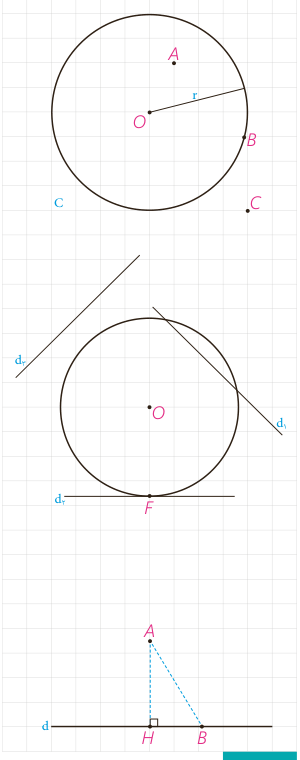

# درس اول: مفاهیم اولیه و زاویه‌ها در دایره

دایره یکی از شکل‌های مهم در هندسه است که در پایه‌های قبل با تعریف و برخی از ویژگی‌های آن آشنا شده‌اید. در ادامه با استفاده از شکل دایره، برخی موارد یادآوری شده است که از قبل با آنها آشنایی دارید.

همان‌طور که می‌دانید تمام نقاطی که روی دایره واقع‌اند از مرکز دایره به یک فاصلۀ ثابت (اندازۀ شعاع دایره) هستند. معمولاً دایرۀ $C$ به مرکز $O$ و شعاع $r$ را به‌صورت $C(O,r)$ نمایش می‌دهیم. با توجه به شکل دایره به سادگی می‌توان نشان داد که:

الف) اگر نقطه‌ای مانند $B$ روی دایره $C(O,r)$ باشد، فاصلۀ آن تا مرکز دایره .......... شعاع دایره است.

ب) اگر نقطه‌ای مانند $C$ بیرون دایره $C(O,r)$ باشد، فاصلۀ آن تا مرکز دایره .......... شعاع دایره است.

پ) اگر نقطه‌ای مانند $A$ درون دایره $C(O,r)$ باشد، فاصلۀ آن تا مرکز دایره .......... شعاع دایره است.

## اوضاع نسبی خط و دایره

در پایه‌های قبل با اوضاع نسبی خط و دایره تا حدودی آشنا شدید و دیدید که یک خط و یک دایره می‌توانند یک یا دو نقطۀ اشتراک داشته، و یا هیچ نقطۀ اشتراکی نداشته باشند.

در حالتی که خط و دایره تنها در یک نقطه مشترک باشند، اصطلاحاً گفته می‌شود خط بر دایره مماس است و در حالتی که خط و دایره دو نقطۀ اشتراک داشته باشند، خط و دایره را متقاطع می‌نامند. در این حالت خط را نسبت به دایره قاطع می‌نامیم.

## یادآوری

اگر خط $d$ و نقطۀ $A$ غیرواقع بر $d$ داده شده، و نقطۀ $H$ پای عمودی باشد که از $A$ به $d$ رسم می‌شود، اندازۀ پاره‌خط $AH$ همان فاصلۀ نقطۀ $A$ از خط $d$ است و فاصلۀ نقطۀ $A$ از دیگر نقاط خط $d$ از این مقدار بزرگ‌تر است ($AB>AH$).

