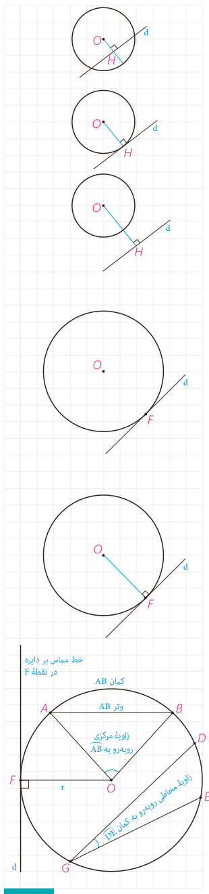

اگر $d$ یک خط و $C(O,r)$ یک دایره و نقطۀ $H$ پای عمودی باشد که از نقطۀ $O$ به خط $d$ رسم می‌شود، موارد زیر را کامل کنید.

الف) اگر فاصلۀ خط $d$ از مرکز دایره از شعاع کمتر باشد ($OH<r$)، خط و دایره ............ نقطۀ اشتراک دارند؛ یعنی متقاطع‌اند.

ب) اگر فاصلۀ خط $d$ از مرکز دایره با شعاع برابر باشد ($OH=r$)، خط و دایره ............ نقطۀ اشتراک دارند؛ یعنی .........

پ) اگر فاصلۀ خط $d$ از مرکز دایره از شعاع بزرگ‌تر باشد ($OH>r$)، خط و دایره ............

## فعالیت

۱- فرض کنیم خط $d$ بر دایرۀ $C$ در نقطۀ $F$ مماس است.

الف) نزدیک‌ترین نقطۀ خط $d$ به نقطۀ $O$ کدام است؟ چرا؟

ب) از $O$ به $d$ عمود کنید. این خط عمود، خط $d$ را در کدام نقطه قطع می‌کند؟ چرا؟

پ) نتیجه: اگر $F$ نقطه‌ای روی دایره باشد، شعاع $OF$ و خط مماس بر دایره در نقطۀ $F$ ............ .

۲- خط $d$ در نقطۀ $F$ به شعاع $OF$ عمود است. با تعیین وضعیت همۀ نقاط خط $d$ نسبت به دایرۀ $C$ نشان دهید این خط با دایره فقط یک نقطۀ تماس دارد و بنابراین بر دایره مماس است.

۳- با توجه به قسمت‌های ۱ و ۲ اگر نقطه‌ای مانند $F$ روی دایره داده شده باشد، چگونه می‌توانید خط مماس بر دایره را در نقطۀ $F$ رسم کنید؟

بنابراین: یک خط و یک دایره بر هم مماس‌اند اگر و تنها اگر این خط در نقطۀ تماس با دایره بر شعاع آن نقطه عمود باشد.

## زوایای مرکزی، محاطی و ظلی

با تعاریف زوایای مرکزی و محاطی و کمان یک دایره در پایه‌های قبل آشنا شده‌اید. در اینجا به یادآوری برخی مفاهیم می‌پردازیم.

۱- **شعاع دایره:** پاره‌خطی که یک سر آن مرکز دایره و سر دیگر آن نقطه‌ای روی دایره باشد.

۲- **وتر دایره:** پاره‌خطی که دو سر آن روی دایره باشند.

