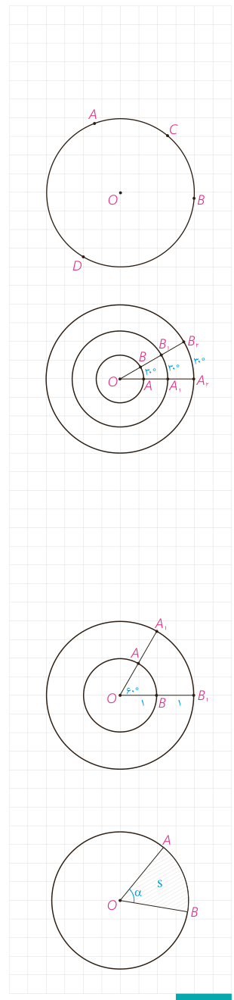

۳- **قطر دایره:** وتری از دایره که از مرکز دایره می‌گذرد.

۴- **زاویۀ مرکزی:** زاویه‌ای است که رأس آن بر مرکز دایره واقع باشد.

۵- **زاویۀ محاطی:** زاویه‌ای است که رأس آن روی دایره و اضلاع آن شامل دو وتر از دایره باشند.

۶- **کمان:** کمان دایره شامل دو نقطه روی دایره و تمام نقاط بین آن دو نقطه است؛ به این ترتیب هر دو نقطه از دایره مانند $A$ و $B$، دو کمان $\widehat{AB}$ را روی دایره مشخص می‌کنند. برای مشخص کردن آنها می‌توان از نقطه‌ای دیگر روی هر کمان استفاده کرد؛ مثلاً در شکل مقابل نقاط $A$ و $B$ دو کمان $\widehat{ACB}$ و $\widehat{ADB}$ را مشخص می‌کنند. معمولاً منظور از $\widehat{AB}$ کمان کوچک‌تر مشخص شده توسط $A$ و $B$ است.

۷- **اندازۀ کمان،** همان اندازۀ زاویۀ مرکزی مقابل به آن کمان تعریف می‌شود و واحد آن درجه است.

۸- با توجه به شکل به سادگی دیده می‌شود که کمان‌های دایره‌های مختلف می‌توانند اندازه‌های برابر و طول‌های نابرابر داشته باشند.

## کار در کلاس

۱- با توجه به اینکه محیط دایره یک کمان به اندازۀ $360^\circ$ است، خواهیم داشت:

$$\frac{\text{اندازۀ کمان }AB}{360}=\frac{\text{طول کمان }AB}{\text{محیط دایره}}$$

۲- با توجه به شکل، اندازۀ کمان‌های زیر را بنویسید.

$$\widehat{AB}=\ldots^\circ\qquad \text{طول }\widehat{AB}=\ldots$$
$$\widehat{A_1B_1}=\ldots^\circ\qquad \text{طول }\widehat{A_1B_1}=\ldots$$

۳- ناحیه‌ای از درون و روی دایره را، که به دو شعاع دایره و آن دایره محدود است یک قطاع دایره می‌نامند. اگر زاویۀ مرکزی قطاعی از دایرۀ $C(O,R)$ برحسب درجه مساوی $\alpha$ باشد، نشان دهید طول کمان $AB$ برابر است با: $L=\frac{\pi R}{180}\alpha$ و مساحت قطاع برابر است با: $S=\frac{\pi R^2\alpha}{360}$.

