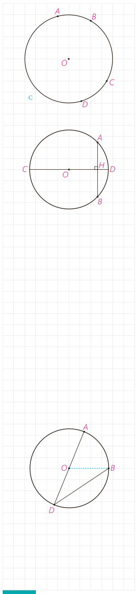

## فعالیت

۱- فرض کنید اندازه‌های کمان‌های $AB$ و $CD$ از دایرۀ $C(O,r)$ باهم برابرند. با تشکیل مثلث‌های $AOB$ و $COD$ نشان دهید وترهای $AB$ و $CD$ نیز باهم برابرند.

۲- فرض کنید دو وتر $AB$ و $CD$ از یک دایره باهم برابرند. ثابت کنید اندازه‌های کمان‌های $AB$ و $CD$ نیز باهم برابرند.

۳- وتر $AB$ و قطری از دایره، که بر وتر $AB$ عمود است، مانند شکل مقابل داده شده است. با تشکیل مثلث‌های $AOH$ و $BOH$ ثابت کنید قطر $CD$ وتر $AB$ و کمان $AB$ را نصف می‌کند.

۴- این بار فرض کنید قطر $CD$ وتر $AB$ را نصف کرده است و نشان دهید $CD$ بر $AB$ عمود است و کمان $AB$ را نصف می‌کند.

۵- حال فرض کنید قطر $CD$ کمان $AB$ را نصف کرده است. نشان دهید $CD$ بر $AB$ عمود است و آن را نصف می‌کند.

۶- اگر نقاط وسط وتر $AB$ و کمان $AB$ را داشته باشیم، چگونه می‌توانیم قطر عمود بر وتر $AB$ را رسم کنیم؟

## فعالیت

۱- در شکل مقابل $\angle ADB$ یک زاویۀ محاطی است که یک ضلع آن از مرکز دایره عبور کرده است.

- اگر از $B$ به $O$ وصل کنیم، زاویۀ $AOB$ یک زاویۀ خارجی برای مثلث $OBD$ است.

بنابراین: $\angle AOB=\angle ODB+\ldots=2\angle ODB$ و از آن نتیجه می‌شود:

$$\angle ODB=\frac12\angle AOB=\frac12\widehat{\ldots}$$

